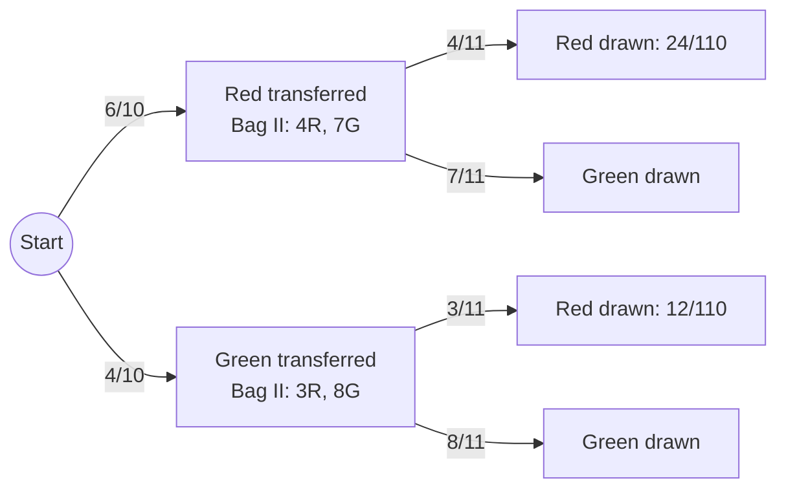

# P2 · Conditional Probability, Independence and Bayes' Rule

> [!abstract] Why this matters for the TF
> This is the ==most reliable topic in Section A==.
>
> It appeared in 2019-20 Q7(a) (truth serum), 2022-23 Q1(a) (ball transfer) and Q1(b) (three machines), and 2023-24 Q1(a), (b) and (c) (a whole 35-mark question). Expect one full question from this note.
>
> The 2022-23 and 2023-24 versions are solved in [[TF 2022-23 Solutions]] and [[TF 2023-24 Solutions]]; every problem shape they use is practised below.

## Core tools (memorize)

> [!important] Memorize
> **Conditional probability**
>
> Use when something is "given" or "known".
>
> $$
> P(A\mid B)=\frac{P(A\cap B)}{P(B)}
> $$
>
> **Multiplication law**
>
> Use for events happening one after another.
>
> $$
> P(A\cap B)=P(A)\,P(B\mid A)
> $$
>
> **Independence test**
>
> $A$ and $B$ are independent if and only if
>
> $$
> P(A\cap B)=P(A)\,P(B)
> $$
>
> **Total probability**
>
> Use when the final event can happen through several routes $B_1,\dots,B_k$.
>
> $$
> P(A)=\sum_{i} P(B_i)\,P(A\mid B_i)
> $$
>
> **Bayes' rule**
>
> Use when the result is given and you want the probability of a route.
>
> $$
> P(B_r\mid A)=\frac{P(B_r)\,P(A\mid B_r)}{\sum_i P(B_i)\,P(A\mid B_i)}
> $$

---

## Theory the TF actually asks

### Define the multiplication law (2023-24 Q1(b))

> [!important] Exam answer: multiplication law of probability
> For two events $A$ and $B$, ==the probability of their simultaneous occurrence is equal to the unconditional probability of one of them multiplied by the conditional probability of the other, given that the first has occurred==.
>
> Symbolically,
>
> $$
> P(A\cap B)=P(A)\,P(B\mid A)=P(B)\,P(A\mid B)
> $$
>
> For three events,
>
> $$
> P(A_1\cap A_2\cap A_3)=P(A_1)\,P(A_2\mid A_1)\,P(A_3\mid A_1\cap A_2)
> $$
>
> and so on for $k$ events.
>
> If $A$ and $B$ are independent, then $P(B\mid A)=P(B)$ and the law becomes
>
> $$
> P(A\cap B)=P(A)\,P(B)
> $$
>
> **Example.** Drawing two cards without replacement,
>
> $$
> P(\text{both aces})=\frac{4}{52}\cdot\frac{3}{51}=\frac{1}{221}
> $$

### Can two events be mutually exclusive and independent at the same time? (2023-24 Q1(a))

> [!important] Exam answer
> If $A$ and $B$ are mutually exclusive, then $A\cap B=\varnothing$, so
>
> $$
> P(A\cap B)=0
> $$
>
> If they are also independent, then
>
> $$
> P(A\cap B)=P(A)\,P(B)
> $$
>
> Together these give $P(A)P(B)=0$, which is possible only if $P(A)=0$ or $P(B)=0$.
>
> Therefore ==two events with non-zero probabilities can never be both mutually exclusive and independent==.
>
> In fact mutually exclusive events are strongly dependent: if $A$ occurs, $B$ certainly does not, so $P(B\mid A)=0\ne P(B)$. The only exception is the trivial case where one event has probability zero.
>
> **Example.** One roll of a die, $A=\{1\}$, $B=\{2\}$. They are mutually exclusive, but
>
> $$
> P(A\cap B)=0\ne\frac16\cdot\frac16
> $$
>
> so they are not independent.

---

## Problem types you will face

### Type 1 — Two-stage problems: ball transfer and "choose a bag" (total probability)

**How to recognise it:** "one ball is transferred unseen from bag I to bag II, then a ball is drawn from bag II", or "a bag is selected at random, then a ball is drawn".

**Recipe:**

1. Define the first-stage events (they form a partition).
2. After a transfer, recount bag II, which now has one more ball.
3. Multiply along each branch and add.

> [!example] Practice 1.1 (same shape as 2022-23 Q1(a) and 2023-24 Q1(b))
> **Given.** Bag I has 6 red and 4 green balls. Bag II has 3 red and 7 green balls. One ball is moved from bag I to bag II unseen, then a ball is drawn from bag II. Find P(red).
>
> **Step 1 — Name the first-stage events.** Let $R_1$ = "transferred ball is red" and $G_1$ = "transferred ball is green".
>
> $$
> P(R_1)=\frac{6}{10},\qquad P(G_1)=\frac4{10}
> $$
>
> Let $R_2$ = "ball drawn from bag II is red".
>
> **Step 2 — Recount bag II for each branch.** If red was moved, bag II has 4 red out of 11. If green was moved, bag II has 3 red out of 11.
>
> $$
> P(R_2\mid R_1)=\frac4{11}
> $$
>
> $$
> P(R_2\mid G_1)=\frac3{11}
> $$
>
> **Step 3 — Total probability.**
>
> $$
> \begin{aligned}
> P(R_2)&=\frac{6}{10}\cdot\frac{4}{11}+\frac{4}{10}\cdot\frac{3}{11}\\
> &=\frac{24+12}{110}\\
> &=\frac{18}{55}\approx0.3273
> \end{aligned}
> $$
>
> **Answer.** $P(\text{red})=\mathbf{18/55\approx0.3273}$.

The tree for this problem looks like this. Multiply along each branch and add the branches that end in the event you want.

> [!example] Practice 1.2 — two balls transferred
> **Given.** Bag I has 3 white and 2 black balls; bag II has 2 white and 4 black balls. Two balls are transferred at random from bag I to bag II, then one ball is drawn from bag II. Find P(white).
>
> **Step 1 — What can be transferred.** The two transferred balls can be WW, WB or BB, out of $\binom52=10$ ways.
>
> $$
> P(WW)=\frac{\binom32}{10}=\frac{3}{10}
> $$
>
> $$
> P(WB)=\frac{3\cdot2}{10}=\frac{6}{10}
> $$
>
> $$
> P(BB)=\frac{1}{10}
> $$
>
> **Step 2 — Recount bag II.** After the transfer, bag II has 8 balls, with 4, 3 or 2 white respectively.
>
> **Step 3 — Total probability.**
>
> $$
> \begin{aligned}
> P(W)&=\frac{3}{10}\cdot\frac48+\frac{6}{10}\cdot\frac38+\frac{1}{10}\cdot\frac28\\
> &=\frac{12+18+2}{80}\\
> &=\frac{32}{80}=0.4
> \end{aligned}
> $$
>
> **Answer.** $P(\text{white})=\mathbf{0.4}$.

> [!example] Practice 1.3 — choose a bag, then reverse it with Bayes
> **Given.** Urn 1 has 2 white and 3 red balls; urn 2 has 4 white and 1 red. A fair coin decides the urn, then one ball is drawn. (i) Find P(white). (ii) If the ball is white, find the probability it came from urn 1.
>
> **Step 1 — (i) Total probability.**
>
> $$
> P(W)=\frac12\cdot\frac25+\frac12\cdot\frac45=\frac15+\frac25=\frac35=0.6
> $$
>
> **Step 2 — (ii) Bayes.**
>
> $$
> P(U_1\mid W)=\frac{\frac12\cdot\frac25}{\frac35}=\frac{1/5}{3/5}=\frac13
> $$
>
> **Answer.** (i) **0.6**, (ii) **1/3**.

> [!warning] Common mistake in transfer problems
> After moving one ball, bag II has one more ball in total.
>
> Students often keep the old total (11 instead of 12, or 10 instead of 11) in the denominator.

---

### Type 2 — Bayes' rule with 2 to 4 causes

**How to recognise it:** an observed result (defective, positive test, did not vote, late, judged guilty) and the question asks for the probability of one cause.

**Recipe (5 steps):**

1. Define the causes $B_i$ and write their priors (they add to 1).
2. Define the observed event $A$ and write $P(A\mid B_i)$. If the data describe the opposite event, take $1-$ the given value.
3. Multiply each prior by its likelihood.
4. Add the products to get $P(A)$.
5. Divide each product by $P(A)$, and check the answers add to 1.

> [!example] Past TF 2019-20 Q7(a) (17 marks) — the truth serum
> **Given.** Let $G$ = guilty and $I$ = innocent. Let $J$ = the serum judges the suspect guilty.
>
> **Step 1 — Priors.**
>
> $$
> P(G)=0.05,\qquad P(I)=0.95
> $$
>
> **Step 2 — Likelihoods.** 90% of the guilty are judged guilty, and innocent suspects are misjudged 1% of the time.
>
> $$
> P(J\mid G)=0.90
> $$
>
> $$
> P(J\mid I)=0.01
> $$
>
> **Step 3 — Total probability.**
>
> $$
> \begin{aligned}
> P(J)&=0.05(0.90)+0.95(0.01)\\
> &=0.045+0.0095\\
> &=0.0545
> \end{aligned}
> $$
>
> **Step 4 — Bayes.**
>
> $$
> P(I\mid J)=\frac{0.95(0.01)}{0.0545}=\frac{0.0095}{0.0545}=0.1743
> $$
>
> **Answer.** $P(\text{innocent}\mid\text{judged guilty})=\mathbf{0.1743}$.
>
> **Comment.** About 17.4% of the suspects the serum calls guilty are actually innocent. Innocent people are so common (95%) that even a 1% error rate produces many false "guilty" verdicts.

> [!example] Practice 2.1 (same shape as 2022-23 Q1(b)) — three suppliers
> **Given.** Suppliers $S_1,S_2,S_3$ provide 50%, 30%, 20% of a component; their defect rates are 1%, 4%, 5%. A component is found defective. Find the probability it came from each supplier.
>
> **Step 1 — Branch products.**
>
> $$
> P(S_1)P(D\mid S_1)=0.5(0.01)=0.005
> $$
>
> $$
> P(S_2)P(D\mid S_2)=0.3(0.04)=0.012
> $$
>
> $$
> P(S_3)P(D\mid S_3)=0.2(0.05)=0.010
> $$
>
> **Step 2 — Total.**
>
> $$
> P(D)=0.005+0.012+0.010=0.027
> $$
>
> **Step 3 — Bayes for each supplier.**
>
> $$
> P(S_1\mid D)=\frac{0.005}{0.027}=0.1852
> $$
>
> $$
> P(S_2\mid D)=\frac{0.012}{0.027}=0.4444
> $$
>
> $$
> P(S_3\mid D)=\frac{0.010}{0.027}=0.3704
> $$
>
> **Answer.** **0.1852, 0.4444, 0.3704** (they add to 1).

> [!example] Practice 2.2 (same shape as 2023-24 Q1(c)) — the "did NOT" twist with four groups
> **Given.** In a town, 40% support party A, 30% party B, 20% party C and 10% party D. In the last election 70% of A, 60% of B, 80% of C and 50% of D supporters voted. A person chosen at random did **not** vote. Find the probability that the person supports each party.
>
> **Step 1 — Use the observed event.** The observed event is $N$ = "did not vote", so the likelihoods are $0.30, 0.40, 0.20, 0.50$.
>
> **Step 2 — Branch products.**
>
> $$
> 0.4(0.3)=0.12
> $$
>
> $$
> 0.3(0.4)=0.12
> $$
>
> $$
> 0.2(0.2)=0.04
> $$
>
> $$
> 0.1(0.5)=0.05
> $$
>
> **Step 3 — Total.**
>
> $$
> P(N)=0.12+0.12+0.04+0.05=0.33
> $$
>
> **Step 4 — Bayes for each party.**
>
> $$
> P(A\mid N)=\frac{0.12}{0.33}=0.3636
> $$
>
> $$
> P(B\mid N)=\frac{0.12}{0.33}=0.3636
> $$
>
> $$
> P(C\mid N)=\frac{0.04}{0.33}=0.1212
> $$
>
> $$
> P(D\mid N)=\frac{0.05}{0.33}=0.1515
> $$
>
> **Answer.** A **0.3636**, B **0.3636**, C **0.1212**, D **0.1515**.

> [!example] Practice 2.3 — medical test
> **Given.** A disease affects 1% of a population. A test detects it in 90% of people who have it, but also gives a positive result for 2% of healthy people. (i) Find P(positive). (ii) A person tests positive; find the probability they have the disease. (iii) A person tests negative; find the probability they still have the disease.
>
> **Step 1 — (i) Total probability.**
>
> $$
> \begin{aligned}
> P(+)&=0.01(0.90)+0.99(0.02)\\
> &=0.009+0.0198\\
> &=0.0288
> \end{aligned}
> $$
>
> **Step 2 — (ii) Bayes for a positive result.**
>
> $$
> P(D\mid +)=\frac{0.009}{0.0288}=0.3125
> $$
>
> **Step 3 — (iii) Bayes for a negative result.**
>
> $$
> P(D\mid -)=\frac{0.01(0.10)}{1-0.0288}=\frac{0.001}{0.9712}=0.00103
> $$
>
> **Answer.** (i) **0.0288**, (ii) **0.3125**, (iii) **0.00103**.
>
> **Comment.** Only about 31% of positive results are real, because the disease is rare.

> [!example] Practice 2.4 — getting to work
> **Given.** A person goes to work by car 30% of the time, walks 30% of the time and takes the bus 40% of the time. The probability of being late is 0.05 by car, 0.10 walking and 0.20 by bus. Given that the person was late, which mode is most likely?
>
> **Step 1 — Branch products.**
>
> $$
> 0.3(0.05)=0.015
> $$
>
> $$
> 0.3(0.10)=0.03
> $$
>
> $$
> 0.4(0.20)=0.08
> $$
>
> **Step 2 — Total.**
>
> $$
> P(L)=0.015+0.03+0.08=0.125
> $$
>
> **Step 3 — Bayes.**
>
> $$
> P(\text{car}\mid L)=\frac{0.015}{0.125}=0.12
> $$
>
> $$
> P(\text{walk}\mid L)=\frac{0.03}{0.125}=0.24
> $$
>
> $$
> P(\text{bus}\mid L)=\frac{0.08}{0.125}=0.64
> $$
>
> **Answer.** The **bus** is the most likely mode (0.64).

> [!warning] The most common Bayes mistake
> When the data say "65% of A supporters voted" but the chosen person did **not** vote, you must use $0.35$, not $0.65$.
>
> Always use the probability of the event that was actually observed.

---

### Type 3 — Dependent draws (multiplication law)

**How to recognise it:** items drawn one after another without replacement, and a specific sequence is asked.

**Recipe:** multiply the probabilities step by step, updating the counts after each draw.

> [!example] Practice 3.1 — sequence of draws
> **Given.** A box has 20 items, 5 defective. Three are drawn one by one without replacement. Find P(first two good and third defective).
>
> **Step 1 — Multiply, updating counts after each draw.**
>
> $$
> P(G_1\cap G_2\cap D_3)=\frac{15}{20}\cdot\frac{14}{19}\cdot\frac{5}{18}=\frac{35}{228}
> $$
>
> **Answer.** $\mathbf{35/228\approx0.1535}$.

> [!example] Example 3.2 (lecture) — TV show
> **Given.** $P(H)=0.4$ (husband watches), $P(W)=0.5$ (wife watches), $P(H\mid W)=0.7$. Find (a) P(both watch), (b) $P(W\mid H)$, (c) P(at least one watches).
>
> **Step 1 — (a) Both watch (multiplication law).**
>
> $$
> P(W\cap H)=P(W)\,P(H\mid W)=0.5\times0.7=0.35
> $$
>
> **Step 2 — (b) Conditional probability.**
>
> $$
> P(W\mid H)=\frac{0.35}{0.4}=0.875
> $$
>
> **Step 3 — (c) Addition rule.**
>
> $$
> P(W\cup H)=0.5+0.4-0.35=0.55
> $$
>
> **Answer.** (a) **0.35**, (b) **0.875**, (c) **0.55**.

> [!example] Example 3.3 (lecture) — dice
> **Given.** Two dice are thrown. Find P(sum $\ge10$ given the first die shows 5).
>
> **Step 1 — Count.** $B$ = "first die is 5" has 6 outcomes. Of these, $(5,5)$ and $(5,6)$ give sum $\ge 10$.
>
> **Step 2 — Conditional probability.**
>
> $$
> P(A\mid B)=\frac{2/36}{6/36}=\frac13
> $$
>
> **Answer.** $\mathbf{1/3}$.

---

### Type 4 — Checking independence

**How to recognise it:** "are A and B independent?"

**Recipe:** compute $P(A\cap B)$ and $P(A)P(B)$. Equal means independent.

> [!example] Practice 4.1
> **(i) Given.** $P(A)=0.4$, $P(B)=0.5$, $P(A\cup B)=0.7$. Are $A$ and $B$ independent?
>
> $$
> P(A\cap B)=0.4+0.5-0.7=0.2
> $$
>
> $$
> P(A)\,P(B)=0.4\times0.5=0.2
> $$
>
> Equal, so **independent**.
>
> **(ii) Given.** A die is rolled. $A$ = "even", $B$ = "at most 4". Are they independent?
>
> $A\cap B=\{2,4\}$, so
>
> $$
> P(A\cap B)=\frac26=\frac13
> $$
>
> $$
> P(A)\,P(B)=\frac12\cdot\frac46=\frac13
> $$
>
> Equal, so **independent**.

---

### Type 5 — Independent people or parts working together

**How to recognise it:** "three students try independently", "the problem is solved if at least one solves it".

**Recipe:**

$$
P(\text{solved})=1-\prod P(\text{fails})
$$

"Exactly one" is the sum of the "only this one" cases.

> [!example] Practice 5.1
> **Given.** Three students solve a problem independently with probabilities $\frac12,\frac13,\frac14$. Find the probability that (i) the problem is solved, (ii) exactly one solves it.
>
> **Step 1 — (i) Nobody solves.**
>
> $$
> P(\text{none})=\frac12\cdot\frac23\cdot\frac34=\frac14
> $$
>
> $$
> P(\text{solved})=1-\frac14=\frac34
> $$
>
> **Step 2 — (ii) Exactly one.**
>
> $$
> \begin{aligned}
> P&=\frac12\cdot\frac23\cdot\frac34+\frac12\cdot\frac13\cdot\frac34+\frac12\cdot\frac23\cdot\frac14\\
> &=\frac{6+3+2}{24}\\
> &=\frac{11}{24}\approx0.458
> \end{aligned}
> $$
>
> **Answer.** (i) **3/4**, (ii) **11/24 ≈ 0.458**.

---

## Extra practice

> [!question]- Answers (try first)
> **1.** Bag A: 4 white, 6 black; bag B: 5 white, 5 black. One ball moves from A to B, then a ball is drawn from B. P(white)?
>
> *Answer:* $\frac4{10}\cdot\frac6{11}+\frac6{10}\cdot\frac5{11}=\frac{54}{110}=\frac{27}{55}\approx0.491$.
>
> **2.** Machines produce 60% and 40% of output with defect rates 3% and 5%. An item is defective; P(from machine 2)?
>
> *Answer:* $0.02/0.038=0.526$.
>
> **3.** $P(A)=0.3$, $P(B)=0.4$, independent. Find $P(A\cup B)$.
>
> *Answer:* $0.58$.
>
> **4.** Two cards drawn without replacement. P(both hearts)?
>
> *Answer:* $\frac{13}{52}\cdot\frac{12}{51}=\frac1{17}$.
>
> **5.** Can $A$ and $B$ with $P(A)=0.2$, $P(B)=0.3$ be mutually exclusive and independent?
>
> *Answer:* No, because $0\ne0.06$.

Previous: [[P1 Probability Basics and Counting]] · Next: [[P3 Random Variables PMF PDF CDF]] · Home: [[index]]
