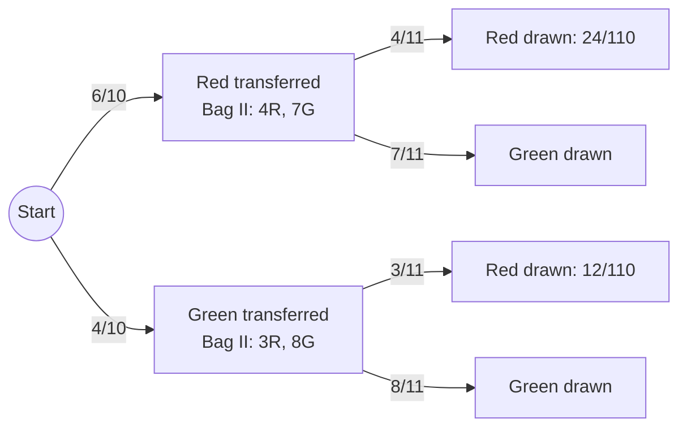

# P2 · Conditional Probability, Independence and Bayes' Rule

> [!abstract] Why this matters for the term final
> This is the ==single most reliable topic in Section A==. It appeared in 2019-20 Q7(a) (truth serum, Bayes), 2022-23 Q1(a) (transfer a ball from bag 1 to bag 2) and Q1(b) (three machines, Bayes), and 2023-24 Q1(a) (can events be mutually exclusive and independent?), Q1(b) (define the multiplication law, then a ball-transfer problem) and Q1(c) (opinion poll, Bayes). Expect at least one full question of 30–35 marks from this note. The 2022-23 and 2023-24 versions are solved in [[TF 2022-23 Solutions]] and [[TF 2023-24 Solutions]]; here you learn the method and practise on similar problems.

---

## 1. Conditional probability

Very often we learn some information before we compute a probability. The **conditional probability** of $A$ given $B$, written $P(A\mid B)$, is the probability that $A$ occurs when we already know that $B$ has occurred. Knowing that $B$ happened shrinks the sample space down to $B$, and inside this smaller space we look at the part where $A$ also happens, which is $A\cap B$.

> [!important] Memorize: Conditional probability
> $$
> P(A\mid B)=\frac{P(A\cap B)}{P(B)}, \qquad P(B)\neq 0 .
> $$
> Read $P(A\mid B)$ as "the probability of $A$ given $B$". In general $P(A\mid B)\neq P(B\mid A)$ and $P(A\mid B)\ne P(A)$.

**Worked example (lecture Problem 01).** A pair of dice is thrown. Find the probability that the sum is 10 or more, given that a 5 appears on the first die.

Let $A$ be "sum is 10 or more" and $B$ be "first die shows 5". The event $B$ contains 6 outcomes, $(5,1),\dots,(5,6)$, so $P(B)=6/36$. Among these, only $(5,5)$ and $(5,6)$ have a sum of 10 or more, so $P(A\cap B)=2/36$. Therefore

$$
P(A\mid B)=\frac{2/36}{6/36}=\frac13 .
$$

---

## 2. The multiplication law (law of compound probability)

If we rearrange the definition of conditional probability, we get a rule for the probability that two events happen together.

> [!important] Memorize: Multiplication law — definition (asked in 2023-24 Q1(b))
> For two events $A$ and $B$, ==the probability of their simultaneous occurrence equals the unconditional probability of one of them multiplied by the conditional probability of the other, given that the first has occurred==. Symbolically,
> $$
> P(A\cap B)=P(A)\,P(B\mid A)=P(B)\,P(A\mid B).
> $$
> For three events, $P(A_1\cap A_2\cap A_3)=P(A_1)\,P(A_2\mid A_1)\,P(A_3\mid A_1\cap A_2)$, and the pattern continues for $k$ events.
> If $A$ and $B$ are independent, the law simplifies to $P(A\cap B)=P(A)P(B)$.

When a question says "define the multiplication law", write the statement in words, write the formula, mention the independent special case, and give a one-line example such as drawing two cards without replacement: $P(\text{both aces})=\frac{4}{52}\cdot\frac{3}{51}$.

**Worked example (lecture Problem 02).** The probability that a married man watches a certain TV show is 0.4, the probability that his wife watches it is 0.5, and the probability that the man watches it given that his wife does is 0.7. Find the probability that both watch, the probability that the wife watches given that the husband does, and the probability that at least one watches.

Let $H$ be "husband watches" and $W$ be "wife watches". By the multiplication law, $P(W\cap H)=P(W)P(H\mid W)=0.5\times 0.7=0.35$. Then $P(W\mid H)=\frac{P(W\cap H)}{P(H)}=\frac{0.35}{0.40}=0.875$. Finally, by the addition rule, $P(W\cup H)=0.5+0.4-0.35=0.55$.

---

## 3. Independent events

Two events are **independent** if the occurrence of one does not change the probability of the other, that is $P(A\mid B)=P(A)$. Substituting into the multiplication law gives the working test.

> [!important] Memorize: Independence
> $A$ and $B$ are independent if and only if
> $$
> P(A\cap B)=P(A)\,P(B).
> $$
> If $A$ and $B$ are independent, then so are $A$ and $B^c$, $A^c$ and $B$, and $A^c$ and $B^c$.

Tossing a coin and rolling a die are independent experiments, so $P(H \text{ and } 6)=\frac12\cdot\frac16=\frac1{12}$. Drawing two cards without replacement is a dependent situation, because the first card changes what is left in the deck.

### Can two events be mutually exclusive and independent at the same time? (2023-24 Q1(a))

> [!important] Memorize: The answer and the justification
> Suppose $A$ and $B$ are mutually exclusive, so $A\cap B=\emptyset$ and $P(A\cap B)=0$. If they were also independent we would need $P(A\cap B)=P(A)P(B)$, that is $0=P(A)P(B)$. This is only possible if $P(A)=0$ or $P(B)=0$.
> So ==two events with non-zero probabilities can never be both mutually exclusive and independent==. In fact, mutually exclusive events with positive probabilities are strongly *dependent*: if $A$ happens, we know for certain that $B$ did not happen, so $P(B\mid A)=0\neq P(B)$. The only exception is the trivial case where at least one of the events has probability zero (for example an impossible event), which is independent of everything and also disjoint from everything.

A simple illustration helps in the exam. When a die is rolled, let $A=\{1\}$ and $B=\{2\}$. They are mutually exclusive. But $P(A)P(B)=\frac1{36}\ne 0=P(A\cap B)$, so they are not independent. Knowing that a 1 appeared tells us for sure that 2 did not appear.

---

## 4. The total probability rule

Many problems describe a process in two stages: first something happens that can go several ways (which machine, which party, which bag, which colour was transferred), and then the event of interest happens with a probability that depends on the first stage. The total probability rule adds up all the routes.

> [!important] Memorize: Theorem of total probability
> If $B_1,B_2,\dots,B_k$ form a partition of the sample space (mutually exclusive and exhaustive, each with $P(B_i)>0$), then for any event $A$,
> $$
> P(A)=\sum_{i=1}^{k}P(B_i)\,P(A\mid B_i)=P(B_1)P(A\mid B_1)+\cdots+P(B_k)P(A\mid B_k).
> $$

The logic is simple. The event $A$ can happen together with $B_1$, or together with $B_2$, and so on; these pieces do not overlap, so we add them, and each piece is computed with the multiplication law.

### Ball-transfer problems

The classic exam form is: "One ball is transferred unseen from bag 1 to bag 2, then a ball is drawn from bag 2." The first stage (the colour of the transferred ball) is the partition. The trick is to remember that after the transfer, bag 2 has ==one more ball than before==, and one more of the transferred colour.

**Fresh practice (similar to 2022-23 Q1(a) and 2023-24 Q1(b)).** Bag I contains 6 red and 4 green balls. Bag II contains 3 red and 7 green balls. One ball is drawn from Bag I and placed unseen in Bag II. A ball is then drawn from Bag II. What is the probability that it is red?

Let $R_1$ be "the transferred ball is red" and $G_1$ be "the transferred ball is green". These two events form a partition, with $P(R_1)=\frac{6}{10}$ and $P(G_1)=\frac{4}{10}$. Let $R_2$ be "the ball drawn from Bag II is red".

If a red ball was transferred, Bag II now has $3+1=4$ red balls out of $10+1=11$, so $P(R_2\mid R_1)=\frac{4}{11}$. If a green ball was transferred, Bag II still has 3 red balls out of 11, so $P(R_2\mid G_1)=\frac{3}{11}$. By the total probability rule,

$$
P(R_2)=\frac{6}{10}\cdot\frac{4}{11}+\frac{4}{10}\cdot\frac{3}{11}=\frac{24+12}{110}=\frac{36}{110}=\frac{18}{55}\approx 0.3273 .
$$

The same tree, drawn as a diagram, looks like this. Multiply along each branch and add the branches that end in the event you want.

> [!tip] Exam trick
> Always write a sentence that defines your events before you write numbers ("Let $W_1$ be the event that a white ball is transferred..."). Examiners give marks for clear event definitions, and it stops you from mixing up $P(A\mid B)$ and $P(B\mid A)$.

---

## 5. Bayes' rule

Bayes' rule answers the *reverse* question. We observe the final result (the product is defective, the person did not vote, the serum says guilty) and want the probability that it came through a particular route $B_r$.

> [!important] Memorize: Bayes' theorem
> If $B_1,\dots,B_k$ form a partition of $S$ with $P(B_i)>0$, and $P(A)>0$, then
> $$
> P(B_r\mid A)=\frac{P(B_r)\,P(A\mid B_r)}{\sum_{i=1}^{k}P(B_i)\,P(A\mid B_i)}=\frac{P(B_r)\,P(A\mid B_r)}{P(A)} .
> $$
> In words: ==posterior = (prior × likelihood of that route) ÷ (total probability of the observed result)==. The numerator is just one branch of the tree; the denominator is the sum of all branches that lead to $A$.

> [!tip] A five-step routine for every Bayes question
> Step 1, define the partition events $B_1,\dots,B_k$ and write their prior probabilities, which must add to 1. Step 2, define the observed event $A$ and write $P(A\mid B_i)$ for each $i$. Be careful when the question gives the *opposite* event: if it says "65% of party A supporters voted" and the person *did not* vote, you need $P(\text{not voted}\mid A)=0.35$. Step 3, compute each product $P(B_i)P(A\mid B_i)$. Step 4, add them to get $P(A)$. Step 5, divide each product by $P(A)$. As a final check, the posteriors must add to 1.

### Past TF solved: 2019-20 Q7(a)

> [!example] Past TF 2019-20 Q7(a) (17 marks) — the truth serum
> **Setting up.** Let $G$ be the event that the suspect is guilty and $I$ the event that the suspect is innocent. Only 5% of the group have ever committed a crime, so the priors are $P(G)=0.05$ and $P(I)=0.95$. Let $J$ be the event that the serum judges the suspect guilty. The serum judges 90% of guilty suspects properly, so $P(J\mid G)=0.90$. Innocent suspects are misjudged (that is, judged guilty) 1% of the time, so $P(J\mid I)=0.01$.
>
> **Total probability that the serum says guilty.**
> $$
> P(J)=P(G)P(J\mid G)+P(I)P(J\mid I)=0.05(0.90)+0.95(0.01)=0.045+0.0095=0.0545 .
> $$
> **Bayes' rule.** We want the probability that he is innocent although the serum says guilty:
> $$
> P(I\mid J)=\frac{P(I)P(J\mid I)}{P(J)}=\frac{0.0095}{0.0545}=0.1743 .
> $$
> **Comment.** About 17.4% of the suspects whom the serum labels guilty are actually innocent. Although the serum is wrong only 1% of the time for an innocent person, innocent people are so much more common (95%) that they make up a noticeable share of the "guilty" verdicts.

### Fresh practice in the style of 2022-23 Q1(b)

A factory buys a component from three suppliers $S_1, S_2, S_3$ in the proportions 50%, 30% and 20%. From past records, 1%, 4% and 5% of their components are defective. A component is picked at random and found to be defective. Find the probability that it came from each supplier.

The priors are $P(S_1)=0.5$, $P(S_2)=0.3$, $P(S_3)=0.2$, and the likelihoods are $P(D\mid S_1)=0.01$, $P(D\mid S_2)=0.04$, $P(D\mid S_3)=0.05$. The branch products are $0.5(0.01)=0.005$, $0.3(0.04)=0.012$ and $0.2(0.05)=0.010$, so

$$
P(D)=0.005+0.012+0.010=0.027 .
$$

Then by Bayes' rule,

$$
P(S_1\mid D)=\frac{0.005}{0.027}=0.1852,\qquad P(S_2\mid D)=\frac{0.012}{0.027}=0.4444,\qquad P(S_3\mid D)=\frac{0.010}{0.027}=0.3704 .
$$

These add to 1, as they must. Notice that supplier $S_1$ provides half the components but only about 18.5% of the defective ones, because its defect rate is low.

### Fresh practice in the style of 2023-24 Q1(c) (the "complement" twist)

Using the same factory, suppose instead that the component is found to be **not defective**. Find the probability that it came from each supplier.

Now the observed event is $D^c$, so we need $P(D^c\mid S_1)=0.99$, $P(D^c\mid S_2)=0.96$, $P(D^c\mid S_3)=0.95$. The branch products are $0.495$, $0.288$ and $0.190$, giving $P(D^c)=0.973$ (which also equals $1-0.027$, a good check). Hence

$$
P(S_1\mid D^c)=\frac{0.495}{0.973}=0.5087,\qquad P(S_2\mid D^c)=\frac{0.288}{0.973}=0.2960,\qquad P(S_3\mid D^c)=\frac{0.190}{0.973}=0.1953 .
$$

> [!warning] Common mistake
> In questions like 2023-24 Q1(c), the data are given as "65% of A supporters turned up to vote", but the person chosen *did not* vote. Students often plug in 0.65 instead of $1-0.65=0.35$. Always ask yourself which event was actually observed, and use the probability of *that* event under each route.

---

> [!question]- Self-check
> **1.** State the multiplication law in words. *The probability that two events occur together equals the probability of one times the conditional probability of the other given the first.*
> **2.** $P(A)=0.3$, $P(B)=0.4$, $A$ and $B$ independent. Find $P(A\cup B)$. *$0.3+0.4-0.12=0.58$.*
> **3.** Can events with $P(A)=0.2$, $P(B)=0.3$ be both disjoint and independent? *No, since $0\ne 0.06$.*
> **4.** In Bayes' rule, what is the denominator? *The total probability of the observed event, the sum over all branches.*
> **5.** After transferring one ball into a bag of 11 balls, how many balls does it hold? *12.*

Previous: [[P1 Probability Basics and Counting]] · Next: [[P3 Random Variables PMF PDF CDF]] · Home: [[index]]
