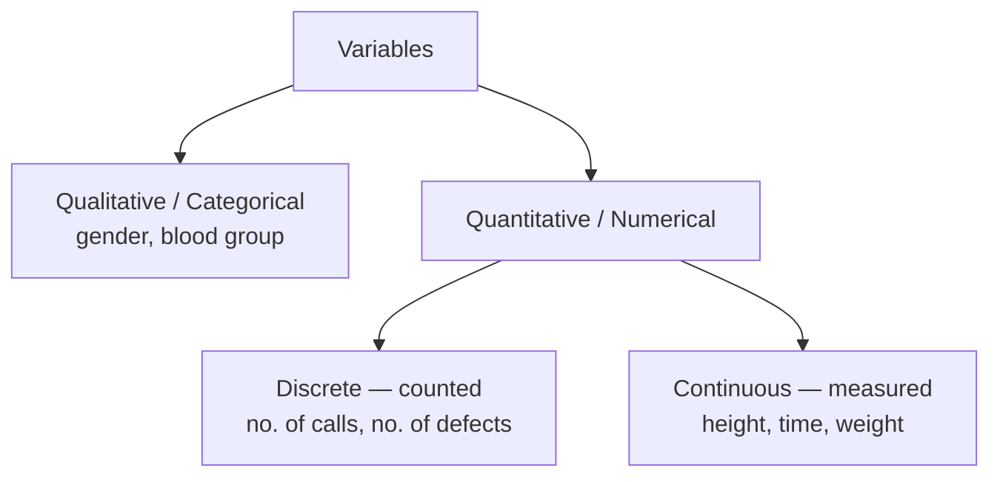

# S1 · Introduction to Statistics, Data and Sampling

**Why this matters for the term final.** This chapter is pure theory, and theory questions are "free marks" if you have the words ready. The 2022-23 term final asked (Q5a, 10 marks) "What do you mean by statistical data? How are they produced? Why do you need statistical data at all? What are the usual sources of statistical data in Bangladesh?" The 2023-24 term final asked (Q6c) you to "explain with an example, stratified random sampling", and Q7a asked for "statistic and parameter" type short notes (also 2022-23 Q7a). Every one of those answers is written out below in exam-ready form. The full answers for those two papers are in [[TF 2022-23 Solutions]] and [[TF 2023-24 Solutions]].

---

## 1. What is statistics?

> [!important] Memorize: Definition of Statistics
> ==Statistics is the science of collecting, organizing, summarizing, analyzing and interpreting data, and of drawing conclusions (making decisions) from data in the presence of uncertainty.==

The word "statistics" is used in two senses. In the plural sense, "statistics" means numerical facts themselves, for example the statistics of rice production in Bangladesh. In the singular sense, "statistics" means the subject, that is, the methods used to collect and analyze such numbers. In an exam, start your answer with the definition above and then add one line of example; that is enough for a 2–3 mark definition.

We study statistics because almost every engineering and computing decision is made with incomplete information. A software team does not know exactly how many users will log in tomorrow, a factory does not know the exact life of each bulb, and a network engineer does not know the exact delay of each packet. Statistics gives us a systematic way to describe what we have seen and to make reliable statements about what we have not seen.

## 2. Population, sample, census

A **population** is the complete collection of all individuals or objects that we are interested in. All the students of BUET, all the bulbs produced by a factory in one year, or all the packets passing through a router in a day are examples of populations.

A **sample** is a part (subset) of the population that we actually observe. If we test 50 bulbs out of the whole production, those 50 bulbs form a sample.

When we collect data from **every** member of the population, the study is called a **census**. Bangladesh's Population and Housing Census is the classic example. A census is accurate but very expensive, slow and sometimes impossible (for example, you cannot test every bulb for its full life, because testing destroys the bulb). That is why we usually work with samples and use probability to generalize from the sample to the population.

A sample is called **representative** if it reflects the characteristics of the population well. A sample is **biased** if it systematically over-represents or under-represents some part of the population, for example, surveying only hall students to estimate the travel time of all BUET students.

## 3. Parameter versus statistic

> [!important] Memorize: Parameter vs Statistic (asked in 2022-23 Q7a)
> A ==parameter== is a numerical characteristic of a **population**, such as the population mean $\mu$, population variance $\sigma^2$ or population proportion $P$. It is a fixed constant, but usually unknown.
>
> A ==statistic== is a numerical characteristic computed from a **sample**, such as the sample mean $\bar{x}$, sample variance $s^2$ or sample proportion $\hat{p}$. It is known once the sample is drawn, but it changes from sample to sample, so it is itself a random variable.
>
> We use statistics to **estimate** and **test** parameters. Example: the average GPA of all students of a college ($\mu$) is a parameter; the average GPA of 40 randomly selected students ($\bar{x} = 2.8$) is a statistic.

A simple memory trick: **P**arameter goes with **P**opulation, **S**tatistic goes with **S**ample. Parameters are usually written with Greek letters ($\mu, \sigma, \rho$) and statistics with Latin letters ($\bar{x}, s, r$).

## 4. Descriptive and inferential statistics

**Descriptive statistics** consists of the collection, organization, summarization and presentation of data. When we make a frequency table, draw a histogram, or compute the mean and standard deviation of the marks of a class, we are doing descriptive statistics. We only describe the data we have; we do not go beyond it.

**Inferential statistics** consists of generalizing from samples to populations, performing estimation and hypothesis tests, determining relationships among variables, and making predictions. Inferential statistics uses probability, because a conclusion drawn from a sample is never 100% certain. When we use 40 students' GPA to say something about all students of the college, or test whether a new machine has a lower defect rate, we are doing inferential statistics.

> [!tip] Exam trick
> If the question's conclusion stays inside the observed data ("the average of these 30 values is 52"), it is descriptive. If the conclusion is about a larger group or the future ("all customers", "the population", "next year"), it is inferential.

## 5. Variables and types of data

A **variable** is a characteristic or attribute that can take different values for different individuals, for example height, gender, number of children, or blood group. The values we record are called **data**; each single value is a **datum** or observation. A collection of observations is a **data set**.

**Qualitative (categorical) variables** place individuals into categories that are not numbers in the usual sense, such as gender, religion, blood group or department. **Quantitative variables** are numerical and can be counted or measured, such as age, income or weight.

Quantitative variables are further divided into two kinds. A **discrete variable** takes values that can be counted, with gaps between them, such as the number of children in a family (0, 1, 2, …) or the number of calls received per hour. A **continuous variable** can take any value in an interval and is obtained by measuring, such as height, temperature, or time to failure. In practice continuous data are rounded (for example, height recorded to the nearest cm), but the underlying variable is still continuous.

There are also four **levels (scales) of measurement**: nominal (names only, e.g. blood group), ordinal (ordered categories, e.g. grade A, B, C), interval (differences meaningful but no true zero, e.g. temperature in °C), and ratio (true zero exists, e.g. weight, income). Ranks used in Spearman's rank correlation ([[S6 Correlation and Regression]]) are ordinal data.

## 6. What is statistical data? How is it produced? Why do we need it?

This section is written as a complete exam answer because 2022-23 Q5(a) asked exactly this.

> [!important] Memorize: Statistical data
> ==Statistical data are aggregates of facts, expressed numerically (or classified into categories), collected in a systematic manner for a pre-determined purpose, and affected to a marked extent by a multiplicity of causes.== A single isolated number (for example "Rahim is 170 cm tall") is not statistics; the heights of 500 students collected to study the average height of students is statistical data. Statistical data must be numerically expressed, reasonably accurate, collected systematically, comparable, and placed in relation to each other.

**How statistical data are produced.** Data are produced in two main ways. ==Primary data== are collected for the first time by the investigator himself or herself for a specific purpose, through methods such as direct personal interview, indirect oral investigation, mailed questionnaires, schedules filled by enumerators, observation and measurement, and designed experiments (for example, testing the life of bulbs in a laboratory). ==Secondary data== are data that were already collected by someone else for some other purpose, and are taken from published or unpublished sources such as government reports, statistical yearbooks, research journals, company records and online databases. In addition, a large share of modern data is produced as a by-product of administration, called **administrative records** (birth and death registration, tax records, hospital records, school enrolment records, mobile phone and banking transaction logs). Data can be produced either by a **census** (every unit is covered) or by a **sample survey** (only a selected part is covered), and either by **observation** (we only record what happens) or by **experiment** (we control some factors and observe the effect).

**Why do we need statistical data?** We need data because sound decisions require facts rather than guesses. The government needs population and income data to plan schools, hospitals, roads and the national budget, and to measure poverty, inflation and unemployment. Businesses need data on sales, costs and customer behavior to forecast demand and control quality. Scientists and engineers need data to test theories, compare designs and measure reliability. In computer science, data are needed to measure system performance, to train and evaluate machine-learning models, and to detect anomalies. Without data, we cannot measure progress, compare alternatives or test claims; statistics turns data into information and information into decisions.

## 7. Sources of statistical data in Bangladesh

> [!important] Memorize: Main sources in Bangladesh (2022-23 Q5a)
> The **==Bangladesh Bureau of Statistics (BBS)==**, under the Statistics and Informatics Division of the Ministry of Planning, is the national statistical office and the most important source. It conducts the **Population and Housing Census** (every 10 years; the latest in 2022), the **Household Income and Expenditure Survey (HIES)** (poverty and income), the **Labour Force Survey (LFS)** (employment and unemployment), the **Agriculture Census** and crop estimates, the **Economic Census**, the **Multiple Indicator Cluster Survey (MICS, with UNICEF)**, and publishes the **Statistical Yearbook of Bangladesh**, the **Monthly Statistical Bulletin**, national accounts (GDP) and the consumer price index (inflation).

Other important sources are the following. **Bangladesh Bank** (the central bank) publishes data on money supply, interest rates, exchange rates, remittances, foreign reserves and balance of payments in its Annual Report and Economic Trends. The **Ministry of Finance** publishes the **Bangladesh Economic Review** every year with the budget. The **Directorate General of Health Services (DGHS)** and its Management Information System (MIS) publish health statistics such as hospital data and disease surveillance; **NIPORT** conducts the **Bangladesh Demographic and Health Survey (BDHS)** on fertility, family planning and child health. **BANBEIS** (Bangladesh Bureau of Educational Information and Statistics) publishes education statistics such as enrolment and number of institutions. Research organizations such as **icddr,b** (health and population research) and **BIDS** (Bangladesh Institute of Development Studies) produce research data. Other sources include the Export Promotion Bureau (export data), the National Board of Revenue (tax data), the Bangladesh Telecommunication Regulatory Commission (mobile and internet subscribers), the Election Commission (voter data) and international organizations such as the World Bank, UNDP, WHO and UNICEF that publish data on Bangladesh.

In the exam, write the BBS paragraph in detail and then name at least four or five other organizations with one line each about what data they provide.

## 8. Sampling methods

Sampling is the process of selecting a sample from a population. The goal is a sample that is representative, so that conclusions about the population are reliable. Sampling methods are divided into **probability sampling** (every unit has a known, non-zero chance of selection) and **non-probability sampling** (selection by judgment or convenience). The course focuses on probability sampling.

**Simple random sampling (SRS).** Every possible sample of size $n$ has the same chance of being selected, so every unit has an equal chance. In practice we number all $N$ units of the population and select $n$ numbers using a lottery or random number generator. Example: number all 500 students of a department and choose 50 using a random number generator. SRS is simple and unbiased, but it needs a complete list (sampling frame) and may, by chance, under-represent small groups.

> [!important] Memorize: Stratified random sampling (asked in 2023-24 Q6c)
> In ==stratified random sampling==, the population is first divided into non-overlapping, internally homogeneous groups called **strata**, based on a characteristic related to the study (for example gender, level, region or income group). Then a simple random sample is drawn **from each stratum separately**, usually in proportion to the stratum size (proportional allocation: $n_h = n \times N_h/N$). The samples from all strata are combined to form the full sample.

**Example of stratified sampling.** Suppose the CSE department has 600 students: 180 in Level 1, 160 in Level 2, 140 in Level 3 and 120 in Level 4. We want a sample of 60 students to estimate average daily screen time, and we believe screen time differs by level. Under proportional allocation we take $60 \times 180/600 = 18$ students from Level 1, $60 \times 160/600 = 16$ from Level 2, $60 \times 140/600 = 14$ from Level 3 and $60 \times 120/600 = 12$ from Level 4, each chosen by simple random sampling within its level. This guarantees that every level is represented in the correct proportion. Because each stratum is homogeneous, stratified sampling usually gives **more precise** estimates (smaller standard error) than SRS of the same size, and it also gives separate estimates for each stratum. Its disadvantage is that we must know the stratum of every unit and the stratum sizes in advance.

**Systematic sampling.** We arrange the population in some order, compute the sampling interval $k = N/n$, choose a random start between 1 and $k$, and then take every $k$-th unit. Example: from a list of 1000 customers we need 50, so $k = 20$; if the random start is 7, we choose customers 7, 27, 47, and so on. It is easy to carry out, but if the list has a periodic pattern matching $k$, the sample can be biased.

**Cluster sampling.** The population is divided into groups called **clusters** (for example villages, schools or city blocks) that are each like a mini-population (heterogeneous inside). A random sample of clusters is chosen, and **all** units (or a sample of units) inside the chosen clusters are studied. Example: to survey household internet use in Dhaka, randomly choose 20 wards and survey every household in those wards. It is cheap when the population is spread out, but usually less precise than SRS of the same size.

> [!warning] Common mistake: strata vs clusters
> In stratified sampling the groups (strata) are **homogeneous inside** and we sample **from every stratum**. In cluster sampling the groups (clusters) are **heterogeneous inside** and we sample **only some clusters**. Do not mix these up in a definition answer.

**Non-probability methods** (mention only briefly): convenience sampling (whoever is easy to reach), judgment or purposive sampling (expert chooses), quota sampling (fill fixed quotas of each group, but not randomly), and snowball sampling (existing subjects recruit others). These are quick and cheap but cannot support valid probability statements.

---

> [!question]- Self-check
> **1. A survey of 400 voters finds 52% support a candidate. Identify the parameter and the statistic.**
> The parameter is the true proportion $P$ of all voters who support the candidate (unknown). The statistic is the sample proportion $\hat p = 0.52$.
>
> **2. Classify: (a) number of bugs in a program, (b) CPU temperature, (c) blood group.**
> (a) quantitative discrete, (b) quantitative continuous, (c) qualitative (nominal).
>
> **3. A university has 3000 science, 2000 engineering and 1000 arts students. How many from each group in a stratified sample of 120 (proportional allocation)?**
> $120 \times 3000/6000 = 60$ science, $120 \times 2000/6000 = 40$ engineering, $120 \times 1000/6000 = 20$ arts.
>
> **4. Name the survey run by BBS that measures poverty.**
> The Household Income and Expenditure Survey (HIES).
>
> **5. Why is a census not used to estimate the mean life of bulbs?**
> Because testing life destroys the bulb; a census would destroy the whole production. A sample is used instead.

---

Previous: [[P9 Uniform Exponential and Other Continuous Distributions]] · Next: [[S2 Frequency Distributions and Graphs]] · Home: [[index]]
