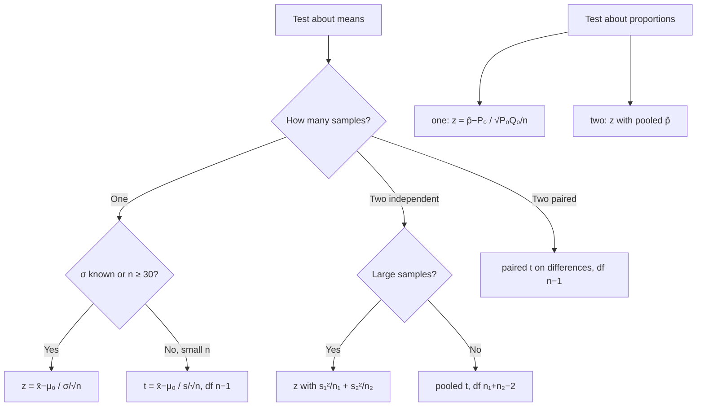

# S8 · Hypothesis Testing: Concepts, z-tests and t-tests

**Why this matters for the term final.** Hypothesis testing carries the most marks in Section B. Every year has at least two test questions. 2019-20 Q6(b): one-mean test with a P-value. 2020-21 Q8(b): one-mean $t$-test; Q8(c): Type I and Type II errors in a DNA paternity setting. 2021-22 Q8(a): small-sample $t$-test on heights. 2022-23 Q7(a): differences between statistic/parameter, critical/acceptance region, exact/inexact hypothesis, uni-/non-directional test, level of significance/p-value; Q7(b): large-sample $z$-test plus a 99% CI; Q7(c): one-tailed $t$-test. 2023-24 Q6(c): one-tailed $z$-test; Q7(a): short notes on goodness of fit, one- and two-tailed tests, degrees of freedom, null and alternative hypotheses; Q7(b): **two-proportion test**; Q7(c): **two-sample pooled $t$-test**. The 2019-20 to 2021-22 questions are solved below; 2022-23 and 2023-24 are in [[TF 2022-23 Solutions]] and [[TF 2023-24 Solutions]], with fresh practice of every type here.

---

## 1. The idea of a test

A **statistical hypothesis** is a statement or assumption about a population parameter (or about the form of a distribution), for example "the mean life of bulbs is 3 years" or "the defect rate is 4%". A **test of hypothesis** is a rule, based on sample data, for deciding whether to reject that statement. We assume the claim is true, see how surprising our sample would be under that assumption, and reject the claim if the sample is too surprising to be explained by chance.

> [!important] Memorize: Null and alternative hypotheses
> The ==null hypothesis $H_0$== is the hypothesis of "no difference" or "no effect" that is tested for possible rejection under the assumption that it is true; it always contains the equality, e.g. $H_0: \mu = \mu_0$. The ==alternative hypothesis $H_1$ (or $H_a$)== is the statement we accept if $H_0$ is rejected; it is what the researcher usually wants to show, e.g. $H_1: \mu \ne \mu_0$, $\mu > \mu_0$ or $\mu < \mu_0$.

> [!tip] Exam trick: writing $H_1$ from the words
> "Is different / has changed / differs" → $\ne$ (two-tailed). "Is greater / more / has increased / exceeds" → $>$ (right-tailed). "Is less / has decreased / has improved (fewer defects or less time)" → $<$ (left-tailed). The claim being tested with words like "at least", "at most", "not more than" goes into $H_0$ as an equality, and the direction of suspicion goes into $H_1$.

## 2. All the concepts (short-note ready)

**Simple and composite (exact and inexact) hypotheses.** A hypothesis that specifies the population completely, i.e. gives a single exact value to the parameter, is called a **simple** or **exact** hypothesis, e.g. $H: \mu = 50$ (with $\sigma$ known). A hypothesis that does not specify the population completely, i.e. allows a range of values, is called **composite** or **inexact**, e.g. $H: \mu > 50$ or $H: \mu \ne 50$. The null hypothesis is usually exact and the alternative is usually inexact.

**Critical (rejection) region and acceptance region.** The set of all possible values of the test statistic is divided into two mutually exclusive parts. The ==critical region $w$== is the set of values for which $H_0$ is rejected; the ==acceptance region $\bar{w}$== is the set for which $H_0$ is not rejected. The boundary values are the **critical values** (for example $\pm1.96$). The size of the critical region equals the level of significance $\alpha$.

**One-tailed (directional, unidirectional) and two-tailed (non-directional) tests.** A test whose critical region lies in only one tail of the sampling distribution is a **one-tailed** test; it is used when $H_1$ has a direction ($>$ or $<$). A test whose critical region is split between both tails ($\alpha/2$ in each) is a **two-tailed** test; it is used when $H_1$ is $\ne$.

![[m243-rejection-regions.png]]

**Level of significance and p-value.** The ==level of significance $\alpha$== is the probability of rejecting $H_0$ when it is actually true (the probability of a Type I error), fixed **before** the test, usually 5% or 1%. The ==p-value== is the probability, computed assuming $H_0$ is true, of getting a test statistic as extreme as or more extreme than the one actually observed; it is computed **after** seeing the data. Decision rule: reject $H_0$ if $p \le \alpha$. The difference: $\alpha$ is a pre-chosen threshold for the whole test, while the p-value is the observed strength of evidence against $H_0$ from this particular sample (smaller p means stronger evidence).

> [!important] Memorize: Type I and Type II errors
> | Decision \ Truth | $H_0$ true | $H_0$ false |
> |---|---|---|
> | Reject $H_0$ | **Type I error** (probability $\alpha$) | Correct (power $= 1-\beta$) |
> | Accept $H_0$ | Correct | **Type II error** (probability $\beta$) |
>
> ==Type I error: rejecting a true null hypothesis. Type II error: accepting (failing to reject) a false null hypothesis.== Like a court: convicting an innocent person is a Type I error; letting a guilty person go free is a Type II error. For a fixed sample size, reducing $\alpha$ increases $\beta$; only a larger sample reduces both.

> [!example] Past TF 2020-21 Q8(c) (10 marks): Type I and II errors in DNA paternity testing
> $H_0$: the man is the father; $H_a$: the man is not the father. The test is 100% accurate if the man is not the father and 99.9% accurate if he is.
>
> **Type I error** = rejecting $H_0$ when it is true = ==concluding that the man is **not** the father when he actually **is** the father==. This happens when the test wrongly excludes a true father. Since the test is 99.9% accurate when he is the father, $\alpha = P(\text{Type I}) = 1 - 0.999 = 0.001$.
>
> **Type II error** = accepting $H_0$ when it is false = ==concluding that the man **is** the father when he actually is **not**==. Since the test is 100% accurate when the man is not the father, it never wrongly includes him, so $\beta = P(\text{Type II}) = 0$.
>
> **Comment.** A Type I error here would wrongly deny a child its real father; a Type II error would wrongly assign fatherhood (legal and financial responsibility) to an unrelated man. The test makes the second error impossible and the first one extremely rare.

**Test statistic.** A test statistic is a quantity computed from the sample whose distribution under $H_0$ is known; it measures how far the sample result is from what $H_0$ predicts, in units of standard error:
$$\text{Test statistic} = \frac{\text{Observed value} - \text{Expected value under } H_0}{\text{Standard error}}$$

**Statistic and parameter.** See [[S1 Introduction to Statistics Data and Sampling]]: a parameter describes the population (fixed, unknown, e.g. $\mu$), a statistic describes the sample (known, varies from sample to sample, e.g. $\bar{x}$).

**Degrees of freedom.** The number of independent observations that are free to vary after the restrictions (such as estimated parameters) are imposed. A one-sample $t$-test has $n - 1$ df, a pooled two-sample $t$-test has $n_1 + n_2 - 2$, a contingency table has $(r - 1)(c - 1)$.

**Goodness of fit.** A goodness-of-fit test checks how well an observed frequency distribution agrees with a theoretical (expected) distribution, using $\chi^2 = \sum \frac{(O - E)^2}{E}$ (see [[S9 Chi-Square Tests]]). A small $\chi^2$ means a good fit.

## 3. The standard answer format (use it in every test question)

> [!important] Memorize: The course's step format
> **1. Hypothesis:** $H_0: \dots$ against $H_1: \dots$
> **2. Level of significance:** $\alpha = \dots$; one- or two-tailed.
> **3. Critical value / critical region:** e.g. reject $H_0$ if $z < -1.645$.
> **4. Test statistic:** write the formula and its distribution, e.g. $z = \frac{\bar{x} - \mu_0}{\sigma/\sqrt{n}} \sim N(0,1)$.
> **5. Calculated value:** substitute the numbers.
> **6. Decision:** compare with the critical value (or p-value with $\alpha$): reject / do not reject $H_0$.
> **7. Comment:** one sentence in the language of the problem ("the claim is not supported", "the machine has improved", etc.).

> [!important] Memorize: Critical values of $Z$
> | | $\alpha = 0.10$ | $\alpha = 0.05$ | $\alpha = 0.01$ |
> |---|---|---|---|
> | Two-tailed ($\pm z_{\alpha/2}$) | 1.645 | ==1.96== | ==2.58== |
> | Right-tailed ($z_\alpha$) | 1.28 | ==1.645== | ==2.33== |
> | Left-tailed ($-z_\alpha$) | −1.28 | −1.645 | −2.33 |

## 4. Choosing the right test

## 5. Tests for one mean

> [!important] Memorize: One-sample $z$ and $t$ tests for $H_0: \mu = \mu_0$
> **Large sample ($n \ge 30$) or $\sigma$ known:** $$z = \frac{\bar{x} - \mu_0}{\sigma/\sqrt{n}} \quad(\text{replace } \sigma \text{ by } s \text{ if unknown}) \sim N(0,1)$$
> **Small sample ($n < 30$), $\sigma$ unknown, normal population:** $$t = \frac{\bar{x} - \mu_0}{s/\sqrt{n}} \sim t_{n-1}, \qquad s = \sqrt{\frac{\sum (x - \bar{x})^2}{n - 1}} = \sqrt{\frac{\sum x^2 - n\bar{x}^2}{n-1}}$$

**p-value calculation.** For a right-tailed test, $p = P(Z \ge z_{cal}) = 1 - \Phi(z_{cal})$. For a left-tailed test, $p = P(Z \le z_{cal}) = \Phi(z_{cal})$. For a two-tailed test, $p = 2\,P(Z \ge |z_{cal}|) = 2[1 - \Phi(|z_{cal}|)]$.

> [!example] Past TF 2019-20 Q6(b) (18 marks): Mice diet, test using a P-value
> **Problem.** Is there reason to believe $\mu < 40$ months if 64 mice on the diet have mean life 38 months and SD 5.8 months?
>
> **Hypothesis:** $H_0: \mu = 40$ against $H_1: \mu < 40$ (left-tailed).
> **Test statistic:** $n = 64$ is large, so $z = \dfrac{\bar{x} - \mu_0}{s/\sqrt{n}} \sim N(0,1)$.
> **Calculated value:** $$z = \frac{38 - 40}{5.8/\sqrt{64}} = \frac{-2}{0.725} = -2.76$$
> **P-value:** $p = P(Z \le -2.76) = 1 - \Phi(2.76) = 1 - 0.9971 = 0.0029$.
> **Decision:** $p = 0.0029$ is smaller than any usual significance level ($0.05$ or even $0.01$), so we reject $H_0$.
> **Comment:** There is strong evidence that the mean life span on this diet is less than 40 months; the student's claim of about 40 months is not supported.

> [!example] Past TF 2020-21 Q8(b) (15 marks): Sodium content of cereal
> **Problem.** $n = 20$ servings, $\bar{x} = 244$ mg, $s = 24.5$ mg. At $\alpha = 0.05$, is the mean sodium content greater than 220 mg?
>
> **Hypothesis:** $H_0: \mu = 220$ against $H_1: \mu > 220$ (right-tailed).
> **Level of significance:** $\alpha = 0.05$; df $= 19$; critical value $t_{0.05,19} = 1.729$. Reject $H_0$ if $t > 1.729$.
> **Test statistic:** small sample, $\sigma$ unknown: $t = \dfrac{\bar{x} - \mu_0}{s/\sqrt{n}} \sim t_{19}$.
> **Calculated value:** $$t = \frac{244 - 220}{24.5/\sqrt{20}} = \frac{24}{5.478} = 4.38$$
> **Decision:** $4.38 > 1.729$, so reject $H_0$.
> **Comment:** The data suggest that the average sodium content of a single serving of this cereal is greater than 220 mg.

> [!example] Past TF 2021-22 Q8(a) (17 marks): Heights of 10 individuals
> **Data.** 63, 63, 64, 65, 66, 69, 69, 70, 70, 71. Test the suggestion that the mean height is 65 ($t_{0.05}$ for 9 df $= 2.262$, two-tailed 5%).
>
> **Calculations.** $\sum x = 670$, so $\bar{x} = 67$. $\sum x^2 = 44978$, so $\sum (x - \bar{x})^2 = 44978 - 10(67)^2 = 44978 - 44890 = 88$. $s^2 = 88/9 = 9.778$, $s = 3.127$.
> **Hypothesis:** $H_0: \mu = 65$ against $H_1: \mu \ne 65$ (two-tailed).
> **Critical region:** $|t| > t_{0.025,9} = 2.262$.
> **Calculated value:** $$t = \frac{67 - 65}{3.127/\sqrt{10}} = \frac{2}{0.989} = 2.02$$
> **Decision:** $|t| = 2.02 < 2.262$, so we do not reject $H_0$.
> **Comment:** The data are consistent with the suggestion that the mean height of the population is 65 inches; the observed difference of 2 inches can be explained by sampling fluctuation.

## 6. Tests for two independent means

> [!important] Memorize: Two-sample tests for $H_0: \mu_1 = \mu_2$
> **Large samples:** $$z = \frac{\bar{x}_1 - \bar{x}_2}{\sqrt{\frac{s_1^2}{n_1} + \frac{s_2^2}{n_2}}} \sim N(0,1)$$
> (with known $\sigma$'s use $\sigma_1^2, \sigma_2^2$; if variances are assumed equal use $s\sqrt{\frac{1}{n_1} + \frac{1}{n_2}}$ in the denominator).
>
> **Small samples, equal variances (pooled $t$):** $$t = \frac{\bar{x}_1 - \bar{x}_2}{s_p\sqrt{\frac{1}{n_1} + \frac{1}{n_2}}} \sim t_{n_1 + n_2 - 2}, \qquad s_p^2 = \frac{\sum(x_1 - \bar{x}_1)^2 + \sum(x_2 - \bar{x}_2)^2}{n_1 + n_2 - 2} = \frac{(n_1 - 1)s_1^2 + (n_2 - 1)s_2^2}{n_1 + n_2 - 2}$$

**Fresh practice (pooled $t$).** Two methods of assembling a part give these times (minutes). Method I: 24, 27, 22, 25, 28, 26. Method II: 21, 23, 20, 24, 22. Is there a significant difference at 5% ($t_{0.025,9} = 2.262$)?

Method I: $n_1 = 6$, $\bar{x}_1 = 152/6 = 25.33$; deviations squared sum $\sum(x_1 - \bar{x}_1)^2 = 23.33$. Method II: $n_2 = 5$, $\bar{x}_2 = 110/5 = 22$; $\sum(x_2 - \bar{x}_2)^2 = 1 + 1 + 4 + 4 + 0 = 10$.

Pooled variance $s_p^2 = (23.33 + 10)/(6 + 5 - 2) = 33.33/9 = 3.704$, so $s_p = 1.925$.

**Hypothesis:** $H_0: \mu_1 = \mu_2$ against $H_1: \mu_1 \ne \mu_2$. **Critical region:** $|t| > 2.262$ with 9 df.
$$t = \frac{25.33 - 22}{1.925\sqrt{\frac{1}{6} + \frac{1}{5}}} = \frac{3.33}{1.925 \times 0.6055} = \frac{3.33}{1.165} = 2.86$$
**Decision:** $2.86 > 2.262$, reject $H_0$. **Comment:** the two methods differ significantly; Method II is faster on average.

> [!tip] Exam trick: computing $\sum (x - \bar{x})^2$ fast
> Use $\sum (x - \bar{x})^2 = \sum x^2 - \frac{(\sum x)^2}{n}$. For Method I: $\sum x^2 = 3874$, $(152)^2/6 = 3850.67$, difference $23.33$. ✓

## 7. Paired $t$-test (two related samples)

When the observations come in natural pairs (before/after on the same person, two years' sales of the same company), compute the differences $d_i = x_i - y_i$ and test whether their mean is zero:
$$t = \frac{\bar{d}}{s_d/\sqrt{n}} \sim t_{n-1}, \qquad s_d = \sqrt{\frac{\sum (d - \bar{d})^2}{n - 1}}$$

**Practice (lecture data).** Sales (million Tk) of 10 companies in 2014 and 2015 give differences 3, 7, 7, 3, 4, 1, 4, 2, 3, 3. $\bar{d} = 37/10 = 3.7$, $s_d = 1.947$, so $t = 3.7/(1.947/\sqrt{10}) = 3.7/0.6155 = 6.01$. With 9 df the two-tailed 5% critical value is 2.262; $6.01 > 2.262$, so reject $H_0$: the sales records of the two years differ significantly (sales fell in 2015).

## 8. Tests for proportions

> [!important] Memorize: Proportion tests
> **One proportion**, $H_0: P = P_0$: $$z = \frac{\hat{p} - P_0}{\sqrt{\frac{P_0(1 - P_0)}{n}}}, \qquad \hat{p} = \frac{x}{n}$$
> **Two proportions**, $H_0: P_1 = P_2$: $$z = \frac{\hat{p}_1 - \hat{p}_2}{\sqrt{\hat{p}(1 - \hat{p})\left(\frac{1}{n_1} + \frac{1}{n_2}\right)}}, \qquad \hat{p} = \frac{x_1 + x_2}{n_1 + n_2} \;(\text{pooled proportion})$$
> Note: in the one-proportion test, the SE uses the **hypothesized** $P_0$, not $\hat{p}$.

**Practice (lecture example, one proportion).** Historically 4% of valves are defective; in a sample of 100, 8 are defective. Has the defect rate changed (5%)? $H_0: P = 0.04$ vs $H_1: P \ne 0.04$. $z = \frac{0.08 - 0.04}{\sqrt{0.04 \times 0.96/100}} = \frac{0.04}{0.0196} = 2.04 > 1.96$, so reject $H_0$: the defect rate has changed (increased).

**Fresh practice (two proportions).** In city A, 30 of 400 sampled phones had a battery fault; in city B, 18 of 400. Test at 5% whether the fault rates differ.
$\hat{p}_1 = 30/400 = 0.075$, $\hat{p}_2 = 18/400 = 0.045$, pooled $\hat{p} = 48/800 = 0.06$.
$H_0: P_1 = P_2$ vs $H_1: P_1 \ne P_2$; reject if $|z| > 1.96$.
$$z = \frac{0.075 - 0.045}{\sqrt{0.06 \times 0.94 \times \left(\frac{1}{400} + \frac{1}{400}\right)}} = \frac{0.030}{0.01679} = 1.79$$
Since $1.79 < 1.96$, we do not reject $H_0$: the difference is not significant at 5% (two-tailed). Note that if the question had asked "is the fault rate **higher** in city A?" (right-tailed, critical value 1.645), we would reject $H_0$. ==The direction of $H_1$ can change the conclusion, so read the question carefully.==

> [!warning] Common mistakes in test questions
> Using a two-tailed critical value for a one-tailed question (or vice versa); forgetting to divide by $\sqrt{n}$; using $n$ instead of $n - 1$ in $s$ for a $t$-test; using $\hat{p}$ instead of $P_0$ in the one-proportion SE; writing "accept $H_1$" without a comment in words. Also note: if the paper gives a critical value (e.g. "$Z = \pm2.58$ at 1%") but your test is one-tailed, write the correct one-tailed value (2.33) and remark that the conclusion is the same with the given value whenever it is.

---

> [!question]- Self-check
> **1. $n = 100$, $\bar{x} = 52$, $\sigma = 10$, $H_0: \mu = 50$ vs $H_1: \mu \ne 50$ at 5%. Decision?**
> $z = 2/1 = 2.0 > 1.96$, reject $H_0$. (p-value $= 2(1 - 0.9772) = 0.0456$.)
>
> **2. What is a Type II error in a test of "the new drug is no better than the old"?**
> Concluding the new drug is no better when in fact it is better.
>
> **3. $n = 9$, $\bar{x} = 21$, $s = 3$, $H_0: \mu = 19$ vs $H_1: \mu > 19$, $t_{0.05,8} = 1.860$. Decision?**
> $t = 2/(3/3) = 2.0 > 1.860$, reject $H_0$.
>
> **4. What df does a pooled $t$-test with samples of 8 and 7 have?**
> $8 + 7 - 2 = 13$.
>
> **5. If the p-value is 0.03, what is the decision at 5% and at 1%?**
> Reject at 5% (0.03 ≤ 0.05); do not reject at 1% (0.03 > 0.01).

---

Previous: [[S7 Sampling Distributions CLT and Confidence Intervals]] · Next: [[S9 Chi-Square Tests]] · Home: [[index]]
