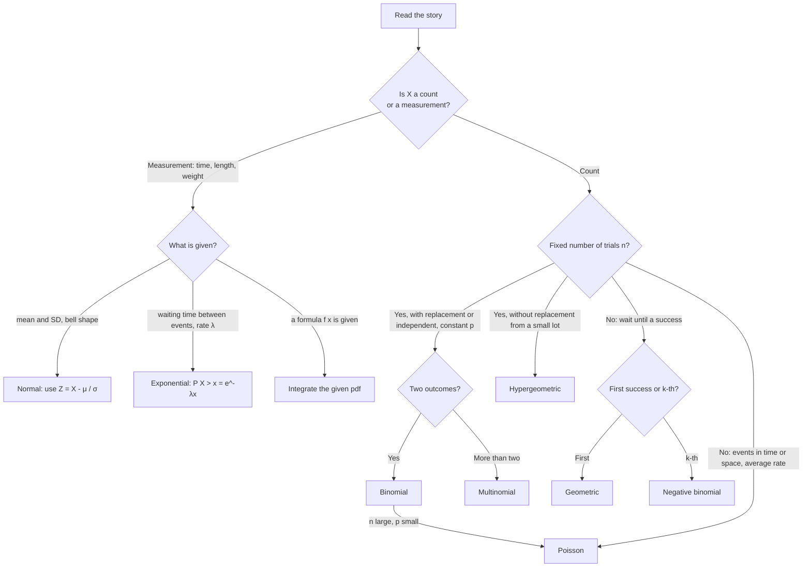
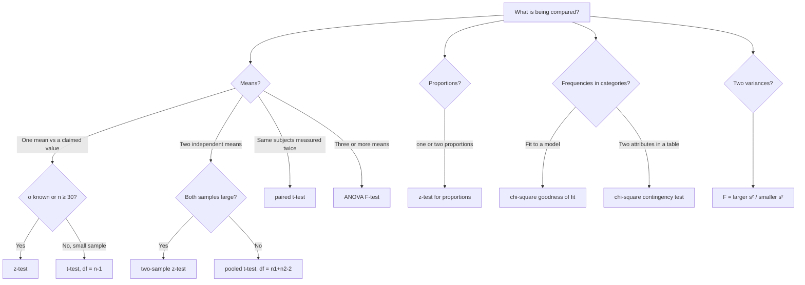

# Exam Answer Templates and Strategy

This page is about *how* to write answers so that you collect full marks, and how to decide quickly which method a question wants.

Most marks in MATH 243 are lost not because a student does not know the formula. They are lost because the student picks the wrong distribution or test, skips a step the examiner expects, or forgets to write a conclusion in words.

Read this page once at the start of your preparation and once again just before the exam.

## Time and question choice

The paper carries 210 marks in 3 hours. You answer three questions from Section A and three from Section B, so each full question is worth 35 marks.

That gives you about ==28 minutes per question==, leaving roughly 10 minutes to read the paper and check.

When you first open the paper, spend two or three minutes marking every part you can do with confidence. Choose questions where the **big-mark parts** are ones you are sure of. A 15 or 20-mark calculation you know is safer than three small theory parts you half remember.

In Section B, the ANOVA, chi-square and moments questions are long but completely mechanical. That makes them excellent choices if you have practised them, since there is no guesswork involved.

> [!tip] Use separate scripts
> The paper says "use separate scripts for each section". Section A answers go in one answer script and Section B answers in another. Mixing them can cost you marks.

## Choosing the right distribution

Most probability questions are a short story, and the first job is to recognise which model the story describes.

The flowchart below captures the decision. The key questions are: is the variable a count or a measurement, is the number of trials fixed, and are we sampling with or without replacement?

> [!tip] Signal words
> "On average ... per minute / per day / per page" → **Poisson**.
>
> "Time between calls" or "time to failure" with a mean → **exponential**.
>
> "Probability of ... is 0.4, if 15 people ..." → **binomial**.
>
> "Lot of 5 contains 2 defective, choose 3" → **hypergeometric**.
>
> "The fifth prescription is the first/third ..." → **geometric / negative binomial**.
>
> "Normally distributed with mean ... and SD ..." → **normal**.

## Choosing the right test

## Template 1: any hypothesis test

The course lectures always use the same layout, and examiners expect it. Write every heading, even when the step is obvious, because each line carries marks.

> [!important] Memorize this layout
> **Hypothesis.**
>
> $$H_0:\ \mu=\mu_0 \quad\text{against}\quad H_1:\ \mu\ne\mu_0$$
>
> (or $>$ or $<$ — read the question's wording).
>
> **Level of significance.** $\alpha=0.05$ (or as given).
>
> **Test statistic.** Write the general formula and state its distribution, for example
>
> $$t=\frac{\bar x-\mu_0}{s/\sqrt n}\sim t_{n-1}$$
>
> **Critical region.** For example, reject $H_0$ if
>
> $$t<-t_{0.05,\,11}=-1.796$$
>
> **Calculated value.** Substitute the numbers and compute.
>
> **Decision.** "Since the calculated value falls in the critical region, we reject $H_0$ at 5% level of significance" (or "falls in the acceptance region, so we do not reject $H_0$").
>
> **Comment.** Translate back into the story in plain words, for example "the new procedure has reduced the mean waiting time".

The direction of $H_1$ comes from the question's words.

**One-tailed** wording: "has the machine improved", "is it less than", "is there reason to believe $\mu<40$", "greater than 220 mg".

**Two-tailed** wording: "is the difference significant", "does it differ", "can it be regarded as coming from a population with mean ...".

> [!warning] P-value questions
> If the question says "use a P-value", compute it from $z_{cal}$.
>
> **Left-tailed test:**
>
> $$p=\Phi(z_{cal})$$
>
> **Right-tailed test:**
>
> $$p=1-\Phi(z_{cal})$$
>
> **Two-tailed test:**
>
> $$p=2\left[1-\Phi(\lvert z_{cal}\rvert)\right]$$
>
> Then reject $H_0$ if $p\le\alpha$.
>
> If no $\alpha$ is given, say "the P-value is very small (less than 0.01), so the evidence against $H_0$ is strong".

## Template 2: total probability and Bayes

**Step 1 — Name the events in words.** Half the marks are for setting up the problem correctly. For example: "Let $B_1, B_2, B_3$ be the events that the product is made by machine 1, 2, 3, and let $D$ be the event that it is defective."

**Step 2 — Write the given probabilities with symbols**, for example $P(B_1)=0.30$ and $P(D\mid B_1)=0.02$. A tree diagram earns marks and prevents mistakes.

**Step 3 — Total probability:**

$$P(D)=\sum_i P(B_i)\,P(D\mid B_i)$$

**Step 4 — Bayes for each cause:**

$$P(B_i\mid D)=\frac{P(B_i)\,P(D\mid B_i)}{P(D)}$$

**Step 5 — Check** that the posterior probabilities add up to 1.

## Template 3: a grouped-data statistics question

**Step 1 — Build a full calculation table** with these columns: class, mid value $x$, frequency $f$, $u$, $fu$, $fu^2$, $fu^3$, $fu^4$ (and cumulative frequency if medians or quantiles are needed). The step deviation is

$$u=\frac{x-A}{h}$$

**Step 2 — Choose $A$** as the mid value of the class with the highest frequency, or one near the middle. This keeps the numbers small.

**Step 3 — Write the totals** in the last row.

**Step 4 — Write each formula, substitute, and give the result** with units.

**Step 5 — Finish with an interpretation sentence** about the shape (skewness and kurtosis) or the comparison (which group is more consistent).

## Template 4: interpretation sentences

Interpretation lines are short but carry real marks.

**Correlation.** Say whether $r$ is positive or negative, and whether it is weak (about 0 to 0.3), moderate (0.3 to 0.7) or strong (above 0.7). Then say what that means in the story.

**CV.** "The group with the smaller CV is more consistent (less variable)."

**Skewness.** "Since $\gamma_1>0$, the distribution is positively skewed, meaning a longer tail to the right and mean greater than mode."

**Kurtosis.** "Since $\beta_2<3$, the distribution is platykurtic, flatter than the normal curve."

**$R^2$.** "About 93% of the variation in yield is explained by the fitted model."

## Reading the statistical tables

**Normal table.** It gives the area to the left of $z$:

$$\Phi(z)=P(Z\le z)$$

For a right tail use

$$P(Z>z)=1-\Phi(z)$$

and for a negative $z$ use

$$\Phi(-z)=1-\Phi(z)$$

For a reverse question such as "find the time above which the slowest 15% of trips lie", look *inside* the table for 0.85 and read off $z\approx1.04$.

**t-table.** Degrees of freedom are on the left and the tail area is at the top. For a two-tailed 5% test you need the column for 0.025.

**Chi-square and F tables.** These are always used as one-tailed (right tail). For $F_{\alpha}(\nu_1,\nu_2)$, $\nu_1$ is the numerator df (between groups) and $\nu_2$ is the denominator df (within groups or error).

In many questions the examiner simply gives you the critical value, so read the question carefully before looking for a table.

> [!example] Critical values that appeared in past papers
> **Chi-square:** $\chi^2_{0.05,4}=9.49$ and $\chi^2_{0.05,1}=3.84$.
>
> **t (two-tailed):** $t_{0.05}(13)=2.16$ and $t_{0.05}(9)=2.262$.
>
> **t (one-tailed):** $t_{0.05}(11)=1.796$ and $t_{0.05}(19)=1.729$.
>
> **F at 5%:** $F(2,9)=4.26$, $F(2,11)=3.98$, $F(3,8)=4.07$, $F(4,12)=3.26$, $F(3,12)=3.49$.
>
> **F at 1%:** $F(3,8)=7.59$.

## Final-week plan

**First pass.** Read the probability notes P1 to P9 and the statistics notes S1 to S10 in order, solving every "Past TF" example yourself before reading its solution.

**Second pass.** Use the [[TF Question Map]] to attempt every 2019-20, 2020-21 and 2021-22 question under time pressure.

**Third pass.** Sit the 2022-23 and 2023-24 papers as mock exams with a timer, and only then compare with [[TF 2022-23 Solutions]] and [[TF 2023-24 Solutions]].

Read the [[Formula Sheet]] every day.

Home: [[index]] · Formulas: [[Formula Sheet]] · Question map: [[TF Question Map]]
