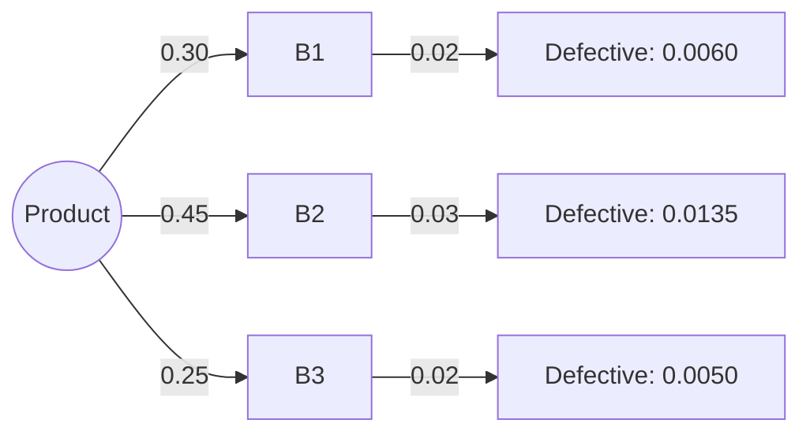

# Term Final 2022-23 — Complete Solutions

This file contains the full solution of every part of the MATH 243 (Probability and Statistics) term final of 2022-23. The questions are not repeated, so keep your printed paper beside you.

Try each part on your own first, then check your work against the steps here.

Notice how each answer is presented: what is given, the formula, the substitution, and then a clear one-line conclusion. Copy that habit on your own script.

> [!summary]- Final answers at a glance
> **Q1(a)** $P(\text{black})=38/63=0.6032$
>
> **Q1(b)** $P(D)=0.0245$; $P(B_1\mid D)=0.2449$, $P(B_2\mid D)=0.5510$, $P(B_3\mid D)=0.2041$
>
> **Q1(c)** $F(x)=1-e^{-x/2000}$; $P(X>1000)=0.6065$; $P(X<2000)=0.6321$
>
> **Q2(a)** $g(x)=\frac{10x}{3}(1-x^3)$, $h(y)=5y^4$, $f(y\mid x)=\frac{3y^2}{1-x^3}$; probability $=8/9$
>
> **Q2(b)** $E(Y)=10$, $\operatorname{Var}(Y)=144$
>
> **Q2(c)** $0.9839$, compared with Chebyshev's bound $\ge0.75$
>
> **Q3(b)** $0.0631+0.0901+0.1126=0.2657$
>
> **Q3(c)** $P(X\ge30)=0.0571$; late 99.11% of the time; 27.95 min; $0.0092$
>
> **Q4(b)** $r_s=0$ (no rank correlation)
>
> **Q4(c)** $y=0.7895+0.8158x$, $x=1.6429+1.1071y$; husband ≈ 34.86 yrs; wife ≈ 21.18 yrs; $r=0.95$
>
> **Q5(b)** 7 classes of width 6 starting from 18
>
> **Q5(c)** A: mean 2146.67, CV 11.01%; B: mean 2070, CV 7.65%; prefer A (longer average life)
>
> **Q6(b)** median 17.65, modes 17.4 and 19.0, range 2.6
>
> **Q6(c)** $\mu_2=152.04$, $\mu_3=21.312$, $\mu_4=47327.5$; $\gamma_1=0.011$, $\gamma_2=-0.95$
>
> **Q7(b)** $z=7.23$, reject; 99% CI $(2.657,\ 2.943)$
>
> **Q7(c)** $t=-2.33<-1.796$, reject; mean now less than 50
>
> **Q8(a)** $\chi^2=220>3.84$, drug effective
>
> **Q8(b)** $F=1.67$, not significant at 5% or 1%
>
> **Q8(c)** blocks $F=0.65$ (not significant); corn $F=5.83$ (significant)

---

# SECTION A

## Q1(a) — Transferring a ball between bags (8 marks)

**Given / setup.** Bag 1 has 4 white and 3 black (7 balls). Bag 2 has 3 white and 5 black (8 balls); after one ball is added it has 9 balls.

Let $W_1$ = the transferred ball is white, $B_1$ = it is black, and $B$ = the ball finally drawn from bag 2 is black.

**Step 1 — Probabilities of the transferred ball.**

$$P(W_1)=\frac47$$

$$P(B_1)=\frac37$$

**Step 2 — Conditional probabilities for the second draw.**

If a white ball was transferred, bag 2 has 4 white and 5 black:

$$P(B\mid W_1)=\frac59$$

If a black ball was transferred, bag 2 has 3 white and 6 black:

$$P(B\mid B_1)=\frac69$$

**Step 3 — Theorem of total probability.**

$$
\begin{aligned}
P(B)&=P(W_1)P(B\mid W_1)+P(B_1)P(B\mid B_1)\\
&=\frac47\cdot\frac59+\frac37\cdot\frac69\\
&=\frac{20+18}{63}\\
&=\frac{38}{63}
\end{aligned}
$$

> [!success] Answer
> $P(\text{black from second bag})=\dfrac{38}{63}\approx0.6032$

Concept: [[P2 Conditional Probability Independence and Bayes]]

---

## Q1(b) — Bayes' theorem: which machine made the defective item? (15 marks)

**Given / setup.** Let $B_1,B_2,B_3$ be the events that a product is made by machines $B_1,B_2,B_3$, and $D$ the event that it is defective.

**Prior probabilities (share of production):**

$$P(B_1)=0.30,\quad P(B_2)=0.45,\quad P(B_3)=0.25$$

**Defective rates of each machine:**

$$P(D\mid B_1)=0.02,\quad P(D\mid B_2)=0.03,\quad P(D\mid B_3)=0.02$$

**Step 1 — Total probability of a defective.**

$$
\begin{aligned}
P(D)&=\sum_i P(B_i)P(D\mid B_i)\\
&=0.30(0.02)+0.45(0.03)+0.25(0.02)\\
&=0.0060+0.0135+0.0050\\
&=0.0245
\end{aligned}
$$

**Step 2 — Bayes' theorem.**

$$P(B_i\mid D)=\frac{P(B_i)P(D\mid B_i)}{P(D)}$$

**Machine $B_1$:**

$$P(B_1\mid D)=\frac{0.0060}{0.0245}=0.2449$$

**Machine $B_2$:**

$$P(B_2\mid D)=\frac{0.0135}{0.0245}=0.5510$$

**Machine $B_3$:**

$$P(B_3\mid D)=\frac{0.0050}{0.0245}=0.2041$$

**Check:** $0.2449+0.5510+0.2041=1$ ✓



> [!success] Answer
> $P(B_1\mid D)=0.2449$
>
> $P(B_2\mid D)=0.5510$
>
> $P(B_3\mid D)=0.2041$
>
> A defective item most likely came from $B_2$.

Concept: [[P2 Conditional Probability Independence and Bayes]]

---

## Q1(c) — Time to failure of a DVD component (12 marks)

**Given / setup.** The density is an exponential distribution with mean $\beta=2000$ hours:

$$f(x)=\frac{1}{2000}e^{-x/2000},\qquad x\ge0$$

**(i) CDF.** For $x<0$, $F(x)=0$. For $x\ge0$:

$$
\begin{aligned}
F(x)&=\int_0^x\frac1{2000}e^{-t/2000}\,dt\\
&=\Big[-e^{-t/2000}\Big]_0^x\\
&=1-e^{-x/2000}
\end{aligned}
$$

So $F(x)=1-e^{-x/2000}$ for $x\ge0$, and $F(x)=0$ for $x<0$.

**(ii) Lasts more than 1000 hours.**

$$P(X>1000)=1-F(1000)=e^{-1000/2000}=e^{-0.5}=0.6065$$

**(iii) Fails before 2000 hours.**

$$P(X<2000)=F(2000)=1-e^{-1}=1-0.3679=0.6321$$

> [!success] Answer
> $F(x)=1-e^{-x/2000}$ for $x\ge0$
>
> $P(X>1000)=0.6065$
>
> $P(X<2000)=0.6321$

Concept: [[P3 Random Variables PMF PDF CDF]] · [[P9 Uniform Exponential and Other Continuous Distributions]]

---

## Q2(a) — Marginal and conditional densities (15 marks)

**Given / setup.** $f(x,y)=10xy^2$ on the triangle $0<x<y<1$.

![[m243-joint-region-triangle.png]]

**Step 1 — Marginal of $X$.** For fixed $x$, $y$ runs from $x$ to 1:

$$
\begin{aligned}
g(x)&=\int_x^1 10xy^2\,dy\\
&=10x\left[\frac{y^3}{3}\right]_x^1\\
&=\frac{10x}{3}(1-x^3),\qquad 0<x<1
\end{aligned}
$$

**Step 2 — Marginal of $Y$.** For fixed $y$, $x$ runs from 0 to $y$:

$$
\begin{aligned}
h(y)&=\int_0^y 10xy^2\,dx\\
&=10y^2\left[\frac{x^2}{2}\right]_0^y\\
&=5y^4,\qquad 0<y<1
\end{aligned}
$$

Check: $\int_0^1 5y^4\,dy=1$ ✓

**Step 3 — Conditional density of $Y$ given $X=x$.**

$$
\begin{aligned}
f(y\mid x)&=\frac{f(x,y)}{g(x)}\\
&=\frac{10xy^2}{\frac{10x}{3}(1-x^3)}\\
&=\frac{3y^2}{1-x^3},\qquad x<y<1
\end{aligned}
$$

**Step 4 — (ii) The conditional probability.** "Spectrum shifts more than half" means $Y>\frac12$. "Temperature increased by 0.25 unit" means $X=0.25$.

At $x=0.25$:

$$1-x^3=1-\frac1{64}=\frac{63}{64}$$

Therefore:

$$
\begin{aligned}
P\left(Y>\tfrac12\,\middle|\,X=0.25\right)&=\int_{1/2}^1\frac{3y^2}{63/64}\,dy\\
&=\frac{64}{63}\Big[y^3\Big]_{1/2}^1\\
&=\frac{64}{63}\cdot\frac78\\
&=\frac89
\end{aligned}
$$

> [!success] Answer
> $g(x)=\frac{10x}{3}(1-x^3)$ for $0<x<1$
>
> $h(y)=5y^4$ for $0<y<1$
>
> $f(y\mid x)=\frac{3y^2}{1-x^3}$ for $x<y<1$
>
> $P(Y>\tfrac12\mid X=0.25)=\frac89\approx0.8889$

Concept: [[P4 Joint Marginal and Conditional Distributions]]

---

## Q2(b) — Mean and variance of $Y=3X-2$ (10 marks)

**Given / setup.** $X$ is exponential with $f(x)=\frac14e^{-x/4}$, $x>0$.

We use the standard integral $\int_0^\infty x^n e^{-x/\beta}dx=n!\,\beta^{n+1}$.

**Step 1 — Mean of $X$.**

$$E(X)=\int_0^\infty x\cdot\frac14e^{-x/4}\,dx=4$$

**Step 2 — Second moment of $X$.**

$$E(X^2)=\int_0^\infty x^2\cdot\frac14e^{-x/4}\,dx=2(4^2)=32$$

**Step 3 — Variance of $X$.**

$$\operatorname{Var}(X)=32-16=16$$

**Step 4 — Apply the rules for $Y=aX+b$.**

$$E(Y)=aE(X)+b$$

$$\operatorname{Var}(Y)=a^2\operatorname{Var}(X)$$

With $a=3$, $b=-2$:

$$E(Y)=3(4)-2=10\text{ minutes}$$

$$\operatorname{Var}(Y)=3^2(16)=144\qquad(\sigma_Y=12\text{ minutes})$$

> [!success] Answer
> $E(Y)=10$ minutes
>
> $\operatorname{Var}(Y)=144$

Concept: [[P5 Expectation Variance Covariance and Chebyshev]]

---

## Q2(c) — $P(\mu-2\sigma<X<\mu+2\sigma)$ vs Chebyshev (10 marks)

**Given / setup.** $f(x)=6x(1-x)$, $0<x<1$.

**Step 1 — Mean.**

$$\mu=E(X)=\int_0^1 6x^2(1-x)\,dx=6\left(\frac13-\frac14\right)=\frac12$$

**Step 2 — Second moment.**

$$E(X^2)=\int_0^1 6x^3(1-x)\,dx=6\left(\frac14-\frac15\right)=\frac{3}{10}$$

**Step 3 — Variance and SD.**

$$\sigma^2=\frac3{10}-\frac14=\frac1{20}$$

$$\sigma=\sqrt{0.05}=0.2236$$

**Step 4 — The interval.**

$$\mu-2\sigma=0.5-0.4472=0.0528$$

$$\mu+2\sigma=0.5+0.4472=0.9472$$

**Step 5 — The CDF.**

$$F(x)=\int_0^x6t(1-t)\,dt=3x^2-2x^3$$

**Step 6 — The exact probability.**

$$
\begin{aligned}
P(0.0528<X<0.9472)&=F(0.9472)-F(0.0528)\\
&=0.99193-0.00807\\
&=0.9839
\end{aligned}
$$

**Step 7 — Chebyshev's theorem.**

$$P(\mu-k\sigma<X<\mu+k\sigma)\ge1-\frac1{k^2}$$

With $k=2$, the probability is at least $1-\frac14=0.75$.

**Comparison.** The exact value 0.9839 is greater than 0.75, so Chebyshev's theorem holds.

Chebyshev only gives a lower bound that is valid for every distribution, so for a specific distribution the true probability is usually much higher than the bound.

> [!success] Answer
> $P(\mu-2\sigma<X<\mu+2\sigma)=0.9839$
>
> This is consistent with (and much larger than) Chebyshev's bound of 0.75.

Concept: [[P5 Expectation Variance Covariance and Chebyshev]]

---

## Q3(a) — Bernoulli and Poisson processes; deriving the Poisson distribution (10 marks)

**Bernoulli process.** A Bernoulli process is a sequence of repeated trials with these properties.

The experiment consists of $n$ repeated trials. Each trial results in only two outcomes, called success and failure. The probability of success $p$ stays the same from trial to trial, and the trials are independent.

The number of successes $X$ in $n$ Bernoulli trials is a binomial random variable:

$$b(x;n,p)=\binom nx p^xq^{n-x}$$

Example: tossing a coin 10 times and counting heads.

**Poisson process.** Experiments that count the number of events in a given interval of time (or region of space) form a Poisson process if the following hold.

The numbers of events in non-overlapping intervals are independent (no memory). The probability of exactly one event in a very short interval of length $\Delta t$ is proportional to its length, about $\lambda\Delta t$, and does not depend on events outside it. The probability of more than one event in such a short interval is negligible.

The number of events $X$ in an interval of length $t$ is then a Poisson random variable with mean $\lambda t$. Examples: calls arriving at a switchboard per hour, typing errors per page, accidents per month.

**Derivation of the Poisson distribution (as a limit of the binomial).**

Divide the interval into $n$ tiny sub-intervals. Each is a Bernoulli trial with success probability $p=\lambda/n$, where $\lambda$ is the mean number of events in the interval.

**Step 1 — Write the binomial probability.**

$$P(X=x)=\binom nx\left(\frac\lambda n\right)^x\left(1-\frac\lambda n\right)^{n-x}$$

**Step 2 — Rearrange the factors.**

$$P(X=x)=\frac{\lambda^x}{x!}\cdot\frac{n(n-1)\cdots(n-x+1)}{n^x}\cdot\left(1-\frac\lambda n\right)^n\cdot\left(1-\frac\lambda n\right)^{-x}$$

**Step 3 — Take the limit $n\to\infty$ of each factor.**

$$\frac{n(n-1)\cdots(n-x+1)}{n^x}=1\left(1-\frac1n\right)\cdots\left(1-\frac{x-1}n\right)\to1$$

$$\left(1-\frac\lambda n\right)^{-x}\to1$$

$$\left(1-\frac\lambda n\right)^n\to e^{-\lambda}$$

**Step 4 — Result.**

$$p(x;\lambda)=\frac{e^{-\lambda}\lambda^x}{x!},\qquad x=0,1,2,\dots$$

This is the Poisson distribution. It is a valid pmf because:

$$\sum_{x=0}^\infty\frac{e^{-\lambda}\lambda^x}{x!}=e^{-\lambda}e^{\lambda}=1$$

Concept: [[P7 Poisson Distribution and Poisson Process]]

---

## Q3(b) — Variance of Poisson, and income-tax errors (12 marks)

**Step 1 — Mean of a Poisson variable.**

$$
\begin{aligned}
E(X)&=\sum_{x=0}^\infty x\frac{e^{-\lambda}\lambda^x}{x!}\\
&=\lambda e^{-\lambda}\sum_{x=1}^\infty\frac{\lambda^{x-1}}{(x-1)!}\\
&=\lambda e^{-\lambda}e^\lambda\\
&=\lambda
\end{aligned}
$$

**Step 2 — The factorial moment $E[X(X-1)]$.**

$$
\begin{aligned}
E[X(X-1)]&=\sum_{x=0}^\infty x(x-1)\frac{e^{-\lambda}\lambda^x}{x!}\\
&=\lambda^2e^{-\lambda}\sum_{x=2}^\infty\frac{\lambda^{x-2}}{(x-2)!}\\
&=\lambda^2e^{-\lambda}e^{\lambda}\\
&=\lambda^2
\end{aligned}
$$

**Step 3 — Second moment.**

$$E(X^2)=E[X(X-1)]+E(X)=\lambda^2+\lambda$$

**Step 4 — Variance.**

$$\operatorname{Var}(X)=E(X^2)-[E(X)]^2=\lambda^2+\lambda-\lambda^2=\lambda$$

For a Poisson variable the mean and the variance are equal, both $\lambda$.

**Problem — Given / setup.** $n=10000$, $p=\frac1{1000}$. Here $n$ is large and $p$ small, so use the Poisson approximation:

$$\lambda=np=10$$

**Step 5 — Individual probabilities.**

$$P(X=6)=\frac{e^{-10}10^6}{6!}=0.0631$$

$$P(X=7)=\frac{e^{-10}10^7}{7!}=0.0901$$

$$P(X=8)=\frac{e^{-10}10^8}{8!}=0.1126$$

**Step 6 — Add them.**

$$P(X=6,7\text{ or }8)=0.0631+0.0901+0.1126=0.2657$$

Check with the cumulative Poisson table:

$$P(X\le8)-P(X\le5)=0.3328-0.0671=0.2657$$

> [!success] Answer
> $\operatorname{Var}(X)=\lambda$
>
> $P(6,7\text{ or }8\text{ returns with error})\approx0.2657$

Concept: [[P7 Poisson Distribution and Poisson Process]]

---

## Q3(c) — The lawyer's commute (13 marks)

**Given / setup.** $X$ = one-way trip time, $X\sim N(\mu=24,\ \sigma=3.8)$.

**Step 1 — At least half an hour.**

$$z=\frac{30-24}{3.8}=1.58$$

$$P(X\ge30)=P(Z\ge1.58)=1-\Phi(1.58)=1-0.9429=0.0571$$

**Step 2 — (i) Late for work.** He leaves at 8:45 and the office opens at 9:00, so he is late if the trip takes more than 15 minutes.

$$z=\frac{15-24}{3.8}=-2.37$$

$$P(X>15)=1-\Phi(-2.37)=1-0.0089=0.9911$$

He is late about **99.11%** of the time.

**Step 3 — (ii) Slowest 15% of trips.** We need $x$ such that $P(X>x)=0.15$, i.e. $\Phi(z)=0.85$.

From the table, $z\approx1.04$. Then:

$$x=\mu+z\sigma=24+1.04(3.8)=27.95\text{ minutes}$$

The slowest 15% of trips take longer than about 27.95 minutes.

**Step 4 — (iii) 2 of the next 3 trips take at least half an hour.** Each trip independently takes at least 30 min with $p=0.0571$.

Let $Y$ = number of such trips among 3, so $Y\sim\text{Bin}(3,\ 0.0571)$.

$$
\begin{aligned}
P(Y=2)&=\binom32(0.0571)^2(0.9429)\\
&=3\times0.00326\times0.9429\\
&=0.0092
\end{aligned}
$$

> [!success] Answer
> $P(X\ge30)=0.0571$
>
> (i) Late 99.11% of the time
>
> (ii) 27.95 minutes
>
> (iii) $0.0092$

Concept: [[P8 Normal Distribution]] · [[P6 Bernoulli Binomial Multinomial Hypergeometric Geometric]]

---

## Q4(a) — Properties of the normal curve; mean, mode and SD (10 marks)

**The normal density:**

$$f(x)=\frac1{\sigma\sqrt{2\pi}}e^{-\frac{(x-\mu)^2}{2\sigma^2}},\qquad -\infty<x<\infty$$

**Properties of the normal curve.**

The curve is bell-shaped and symmetric about the vertical line $x=\mu$. Its mean, median and mode are all equal to $\mu$, and the maximum height $\frac1{\sigma\sqrt{2\pi}}$ occurs at $x=\mu$.

The curve approaches the horizontal axis asymptotically on both sides but never touches it. It has points of inflection at $x=\mu\pm\sigma$, being concave downward between them and concave upward outside.

The total area under the curve is 1. About 68.27%, 95.45% and 99.73% of the area lies within $\mu\pm\sigma$, $\mu\pm2\sigma$ and $\mu\pm3\sigma$ respectively.

Its skewness is 0 and $\beta_2=3$ (mesokurtic). Changing $\mu$ shifts the curve left or right; a larger $\sigma$ makes it flatter and wider.

**Mean.** Put $z=\frac{x-\mu}{\sigma}$, so $x=\mu+\sigma z$ and $dx=\sigma\,dz$:

$$
\begin{aligned}
E(X)&=\int_{-\infty}^\infty x f(x)\,dx\\
&=\int_{-\infty}^{\infty}(\mu+\sigma z)\frac{1}{\sqrt{2\pi}}e^{-z^2/2}\,dz\\
&=\mu\underbrace{\int\frac{e^{-z^2/2}}{\sqrt{2\pi}}dz}_{=1}+\sigma\underbrace{\int z\frac{e^{-z^2/2}}{\sqrt{2\pi}}dz}_{=0\ (\text{odd})}\\
&=\mu
\end{aligned}
$$

**Mode.** Differentiate the density:

$$f'(x)=-\frac{x-\mu}{\sigma^2}f(x)=0\ \Rightarrow\ x=\mu$$

$$f''(\mu)=-\frac{f(\mu)}{\sigma^2}<0$$

So $f$ is maximum at $x=\mu$: mode $=\mu$.

**Standard deviation.** Using integration by parts with $u=z$, $dv=ze^{-z^2/2}dz$:

$$
\begin{aligned}
\operatorname{Var}(X)&=E(X-\mu)^2\\
&=\int_{-\infty}^\infty \sigma^2z^2\frac{e^{-z^2/2}}{\sqrt{2\pi}}\,dz\\
&=\sigma^2\cdot\frac{1}{\sqrt{2\pi}}\left\{\Big[-ze^{-z^2/2}\Big]_{-\infty}^{\infty}+\int_{-\infty}^\infty e^{-z^2/2}dz\right\}\\
&=\sigma^2(0+1)\\
&=\sigma^2
\end{aligned}
$$

So the SD is $\sigma$.

**Standard normal variable.** If $Z=\frac{X-\mu}{\sigma}$, then:

$$E(Z)=\frac{E(X)-\mu}{\sigma}=0$$

$$\operatorname{Var}(Z)=\frac{\operatorname{Var}(X)}{\sigma^2}=1$$

So the standard normal variable always has mean 0 and variance 1, $Z\sim N(0,1)$. This is why a single table of $\Phi(z)$ serves all normal distributions.

Concept: [[P8 Normal Distribution]]

---

## Q4(b) — Correlation vs regression; rank correlation of Bangla and English marks (12 marks)

**Correlation vs regression.**

Correlation analysis measures the degree and direction of the relationship between two variables using a single number (such as $r$, between −1 and +1). Both variables are treated alike as random, and $r_{xy}=r_{yx}$.

Regression analysis finds the actual average functional relationship (an equation such as $y=a+bx$) between a dependent variable and an independent variable, so that the dependent variable can be predicted. The two variables play different roles, and the regression of $Y$ on $X$ is different from that of $X$ on $Y$.

Correlation is a pure number without units, while regression coefficients have units. Correlation does not imply cause and effect, whereas regression is generally used where one variable is considered to influence the other.

**Rank correlation — Step 1: rank each series.** Rank in ascending order; tied values get the average rank.

| Applicant | Bangla | $R_1$ | English | $R_2$ | $D$ | $D^2$ |
|---|---|---|---|---|---|---|
| A | 15 | 2 | 40 | 6 | −4 | 16 |
| B | 20 | 3.5 | 30 | 4 | −0.5 | 0.25 |
| C | 28 | 5 | 50 | 7 | −2 | 4 |
| D | 12 | 1 | 30 | 4 | −3 | 9 |
| E | 40 | 6 | 20 | 2 | 4 | 16 |
| F | 60 | 7 | 10 | 1 | 6 | 36 |
| G | 20 | 3.5 | 30 | 4 | −0.5 | 0.25 |
| H | 80 | 8 | 60 | 8 | 0 | 0 |
| | | | | | Total | 81.5 |

**Step 2 — Tie corrections.**

In Bangla, 20 is repeated twice ($m=2$):

$$\frac{2^3-2}{12}=0.5$$

In English, 30 is repeated three times ($m=3$):

$$\frac{3^3-3}{12}=2$$

**Step 3 — Spearman's formula with ties.**

$$
\begin{aligned}
r_s&=1-\frac{6\left[\sum D^2+\sum\frac{m^3-m}{12}\right]}{n(n^2-1)}\\
&=1-\frac{6(81.5+0.5+2)}{8(64-1)}\\
&=1-\frac{504}{504}\\
&=0
\end{aligned}
$$

**Comment.** The rank correlation is zero: there is no relationship between the ranks of the applicants in Bangla and in English. Doing well in one paper tells us nothing about performance in the other.

> [!success] Answer
> $r_s=0$ — no rank correlation between Bangla and English marks.

Concept: [[S6 Correlation and Regression]]

---

## Q4(c) — Regression of ages of husbands and wives (13 marks)

**Given / setup.** Let $x$ = age of husband, $y$ = age of wife, $n=10$.

| $x$ | $y$ | $x^2$ | $y^2$ | $xy$ |
|---|---|---|---|---|
| 22 | 18 | 484 | 324 | 396 |
| 23 | 20 | 529 | 400 | 460 |
| 23 | 21 | 529 | 441 | 483 |
| 24 | 20 | 576 | 400 | 480 |
| 26 | 21 | 676 | 441 | 546 |
| 27 | 22 | 729 | 484 | 594 |
| 27 | 23 | 729 | 529 | 621 |
| 28 | 24 | 784 | 576 | 672 |
| 30 | 25 | 900 | 625 | 750 |
| 30 | 26 | 900 | 676 | 780 |
| 260 | 220 | 6836 | 4896 | 5782 |

**Step 1 — Means.**

$$\bar x=\frac{260}{10}=26$$

$$\bar y=\frac{220}{10}=22$$

**Step 2 — Sums of squares and products.**

$$S_{xx}=\sum x^2-\frac{(\sum x)^2}{n}=6836-6760=76$$

$$S_{yy}=\sum y^2-\frac{(\sum y)^2}{n}=4896-4840=56$$

$$S_{xy}=\sum xy-\frac{\sum x\sum y}{n}=5782-\frac{260\times220}{10}=5782-5720=62$$

**Step 3 — (i) Regression coefficients.**

$$b_{yx}=\frac{S_{xy}}{S_{xx}}=\frac{62}{76}=0.8158$$

$$b_{xy}=\frac{S_{xy}}{S_{yy}}=\frac{62}{56}=1.1071$$

**Step 4 — Regression equations.**

**$Y$ on $X$:**

$$y-\bar y=b_{yx}(x-\bar x)\ \Rightarrow\ y-22=0.8158(x-26)\ \Rightarrow\ y=0.7895+0.8158x$$

**$X$ on $Y$:**

$$x-\bar x=b_{xy}(y-\bar y)\ \Rightarrow\ x-26=1.1071(y-22)\ \Rightarrow\ x=1.6429+1.1071y$$

**Step 5 — (ii) Husband's age when wife's age is 30.** Use $X$ on $Y$:

$$x=1.6429+1.1071(30)=34.86\approx35\text{ years}$$

**Step 6 — (iii) Wife's age when husband's age is 25.** Use $Y$ on $X$:

$$y=0.7895+0.8158(25)=21.18\approx21\text{ years}$$

**Step 7 — Pearson's correlation coefficient.**

$$r=\frac{S_{xy}}{\sqrt{S_{xx}S_{yy}}}=\frac{62}{\sqrt{76\times56}}=\frac{62}{65.24}=0.9504$$

**Check:**

$$r=\sqrt{b_{yx}\,b_{xy}}=\sqrt{0.8158\times1.1071}=0.9504$$

**Comment.** $r=0.95$ shows a very strong positive linear correlation: older husbands tend to have older wives.

> [!success] Answer
> $Y$ on $X$: $y=0.7895+0.8158x$
>
> $X$ on $Y$: $x=1.6429+1.1071y$
>
> Husband ≈ 34.86 years; wife ≈ 21.18 years
>
> $r=0.95$ (very high positive)

Concept: [[S6 Correlation and Regression]]

---

# SECTION B

## Q5(a) — Statistical data, how produced, why needed, and sources in Bangladesh (10 marks)

**Statistical data.** Statistical data are numerical facts (measurements or counts) about a group of individuals or items, collected in a systematic way for a definite purpose, which can be compared and analysed.

A single number is not statistical data; an aggregate of related facts is. For example, the monthly incomes of 500 households of Dhaka, or the yearly rice production of each district, are statistical data.

**How they are produced.** Data are produced either as **primary data** or as **secondary data**.

Primary data are collected first-hand by the investigator for the specific purpose, through a census (complete enumeration of every unit), a sample survey, direct observation, interviews, questionnaires or experiments.

Secondary data are data already collected by some other agency and taken from published or unpublished records, reports, journals, websites and administrative registers.

Data are also produced continuously as administrative records (birth and death registrations, tax returns, customs records, hospital records) and automatically by digital systems (sensors, transactions, web logs).

**Why we need them.** Without data we cannot describe a situation accurately or make objective decisions.

Government needs data for planning (budgets, schools, hospitals, food and energy supply) and for measuring progress such as GDP growth, inflation, poverty and literacy. Businesses need data for market research, production planning, quality control and forecasting demand. Researchers need data to test hypotheses and build models.

In short, statistical data turn guesswork into evidence-based decision-making.

**Usual sources of statistical data in Bangladesh.**

The main official source is the **Bangladesh Bureau of Statistics (BBS)**. It conducts the Population and Housing Census, the Agriculture Census, the Economic Census, the Household Income and Expenditure Survey (HIES) and the Labour Force Survey, and publishes the Statistical Yearbook of Bangladesh, national accounts (GDP) and the consumer price index (inflation).

Other sources are **Bangladesh Bank** (money, banking, exchange rate, remittance, balance of payments), the **Ministry of Finance** (Bangladesh Economic Review, budget documents), and the **Export Promotion Bureau** and **National Board of Revenue** (trade and tax data).

Health and population data come from the **Directorate General of Health Services** and **NIPORT** (Bangladesh Demographic and Health Survey). The **Bangladesh Election Commission** holds voter data and **BANBEIS** holds education statistics.

Research institutes such as **BIDS** and **icddr,b**, and international organizations such as the World Bank, UNDP, UNICEF and WHO, are further sources.

Concept: [[S1 Introduction to Statistics Data and Sampling]]

---

## Q5(b) — Frequency table by Sturges' rule; histogram and ogive (15 marks)

**Given / setup.**

$$N=60,\qquad \text{smallest}=18,\qquad \text{largest}=57$$

$$\text{Range}=57-18=39$$

**Step 1 — Number of classes (Sturges).**

$$
\begin{aligned}
K&=1+3.322\log_{10}N\\
&=1+3.322\log_{10}60\\
&=1+3.322(1.7782)\\
&=6.91\approx7
\end{aligned}
$$

**Step 2 — Class width.**

$$h=\frac{\text{Range}}{K}=\frac{39}{7}=5.57\approx6$$

**Step 3 — Tally the classes.** Starting from the smallest value 18 with width 6:

| Class limits | Class boundaries | Mid-value | Frequency | Cumulative frequency |
|---|---|---|---|---|
| 18–23 | 17.5–23.5 | 20.5 | 4 | 4 |
| 24–29 | 23.5–29.5 | 26.5 | 5 | 9 |
| 30–35 | 29.5–35.5 | 32.5 | 10 | 19 |
| 36–41 | 35.5–41.5 | 38.5 | 25 | 44 |
| 42–47 | 41.5–47.5 | 44.5 | 9 | 53 |
| 48–53 | 47.5–53.5 | 50.5 | 3 | 56 |
| 54–59 | 53.5–59.5 | 56.5 | 4 | 60 |
| Total | | | 60 | |

**Step 4 — (ii) Histogram and cumulative frequency graph.**

For the histogram, mark the class boundaries on the $x$-axis and frequencies on the $y$-axis, and draw adjacent rectangles whose heights equal the frequencies.

For the cumulative frequency graph (less-than ogive), plot each cumulative frequency against the **upper class boundary** (starting with 0 at 17.5) and join the points with straight lines.

![[m243-tf2223-q5b-hist-ogive.png]]

The histogram shows that most insulation thicknesses lie between 35.5 and 41.5 mm. The distribution is roughly symmetric with a peak in the middle.

Concept: [[S2 Frequency Distributions and Graphs]]

---

## Q5(c) — Which company's bulbs to prefer? (10 marks)

**Given / setup.** Use mid-values $m=1800,2000,2200,2400,2600$ with:

$$A=2200,\qquad h=200,\qquad u=\frac{m-2200}{200}$$

| Life (hrs) | $m$ | $u$ | $f_A$ | $f_Au$ | $f_Au^2$ | $f_B$ | $f_Bu$ | $f_Bu^2$ |
|---|---|---|---|---|---|---|---|---|
| 1700–1900 | 1800 | −2 | 10 | −20 | 40 | 3 | −6 | 12 |
| 1900–2100 | 2000 | −1 | 16 | −16 | 16 | 40 | −40 | 40 |
| 2100–2300 | 2200 | 0 | 20 | 0 | 0 | 12 | 0 | 0 |
| 2300–2500 | 2400 | 1 | 8 | 8 | 8 | 3 | 3 | 3 |
| 2500–2700 | 2600 | 2 | 6 | 12 | 24 | 2 | 4 | 8 |
| Total | | | 60 | −16 | 88 | 60 | −39 | 63 |

**Step 1 — Company A.**

**Mean:**

$$\bar x_A=2200+\frac{-16}{60}(200)=2146.67\text{ hrs}$$

**Standard deviation:**

$$\sigma_A=200\sqrt{\frac{88}{60}-\left(\frac{-16}{60}\right)^2}=200\sqrt{1.39556}=236.27$$

**Coefficient of variation:**

$$CV_A=\frac{236.27}{2146.67}\times100=11.01\%$$

**Step 2 — Company B.**

**Mean:**

$$\bar x_B=2200+\frac{-39}{60}(200)=2070\text{ hrs}$$

**Standard deviation:**

$$\sigma_B=200\sqrt{\frac{63}{60}-\left(\frac{-39}{60}\right)^2}=200\sqrt{0.6275}=158.43$$

**Coefficient of variation:**

$$CV_B=\frac{158.43}{2070}\times100=7.65\%$$

**Decision.** Company A's bulbs last longer on average (2146.67 hours against 2070 hours), while Company B's bulbs are more uniform (smaller CV, 7.65% against 11.01%).

Since the price is the same and the buyer's main interest is the length of life of a bulb, I would prefer **Company A**: on average its bulbs give about 77 more hours of light for the same money.

If the buyer valued consistency more than long life (for example, to replace all bulbs at the same time), Company B would be chosen, because its lives are less variable.

> [!success] Answer
> A: mean 2146.67 h, SD 236.27, CV 11.01%
>
> B: mean 2070 h, SD 158.43, CV 7.65%
>
> Prefer A for longer average life (B is more consistent).

Concept: [[S3 Measures of Central Tendency]] · [[S4 Measures of Dispersion]]

---

## Q6(a) — Definitions with examples (10 marks)

For the examples below, take the small data set 2, 4, 6, 8 with mean $\bar x=5$.

**(i) Standard deviation.** The standard deviation is the positive square root of the mean of the squared deviations of the observations from their arithmetic mean:

$$\sigma=\sqrt{\frac{\sum(x-\bar x)^2}{n}}$$

It measures, in the same units as the data, how far the observations typically lie from the mean.

For the example, the deviations are −3, −1, 1, 3 and their squares add to 20, so:

$$\sigma=\sqrt{20/4}=\sqrt5=2.236$$

**(ii) Variance.** The variance is the mean of the squared deviations from the mean, i.e. the square of the standard deviation:

$$\sigma^2=\frac{\sum(x-\bar x)^2}{n}$$

The sample variance uses divisor $n-1$:

$$s^2=\frac{\sum(x-\bar x)^2}{n-1}$$

For the example, $\sigma^2=20/4=5$ and $s^2=20/3=6.67$. A larger variance means the data are more spread out.

**(iii) Skewness.** Skewness means lack of symmetry in a distribution.

If the longer tail is on the right, the distribution is positively skewed and mean > median > mode (e.g. income of people in a country). If the longer tail is on the left, it is negatively skewed and mean < median < mode (e.g. marks in an easy exam).

It is measured by Karl Pearson's coefficient:

$$Sk_p=\frac{\text{Mean}-\text{Mode}}{\sigma}$$

or by Bowley's coefficient:

$$Sk_B=\frac{Q_3+Q_1-2Q_2}{Q_3-Q_1}$$

or by the moment measure:

$$\gamma_1=\frac{\mu_3}{\mu_2^{3/2}}$$

The example 2, 4, 6, 8 is symmetric, so its skewness is 0.

**(iv) Kurtosis.** Kurtosis is the degree of peakedness or flatness of a frequency curve compared with the normal curve. It is measured by:

$$\beta_2=\frac{\mu_4}{\mu_2^2}\qquad\text{or}\qquad\gamma_2=\beta_2-3$$

If $\beta_2=3$ the curve is mesokurtic (normal). If $\beta_2>3$ it is leptokurtic (more peaked, e.g. daily stock returns). If $\beta_2<3$ it is platykurtic (flatter, e.g. a uniform distribution, which has $\beta_2=1.8$).

**(v) Moments.** The $r$-th moment is the average of the $r$-th powers of the deviations of the observations from a fixed point.

Moments about an arbitrary point $A$ are raw moments:

$$\mu'_r=\frac{\sum f(x-A)^r}{N}$$

Moments about the mean are central moments:

$$\mu_r=\frac{\sum f(x-\bar x)^r}{N}$$

The first raw moment about zero is the mean, the second central moment is the variance, the third central moment measures skewness and the fourth measures kurtosis.

For the example:

$$\mu_2=5$$

$$\mu_3=\frac{-27-1+1+27}{4}=0$$

$$\mu_4=\frac{81+1+1+81}{4}=41$$

Concept: [[S4 Measures of Dispersion]] · [[S5 Moments Skewness and Kurtosis]]

---

## Q6(b) — Stem-and-leaf plot of pencil lengths (10 marks)

**Given / setup.** Use the whole-number part as the stem and the first decimal digit as the leaf.

Ordered data: 16.4, 16.8, 17.2, 17.4, 17.4, 17.5, 17.8, 18.6, 18.7, 18.8, 19.0, 19.0.

**Step 1 — The stem-and-leaf plot.**

```
 16 | 4 8
 17 | 2 4 4 5 8
 18 | 6 7 8
 19 | 0 0            Key: 17 | 4 means 17.4 cm
```

**Step 2 — Median.** $n=12$ is even, so the median is the average of the 6th and 7th ordered values:

$$\text{Median}=\frac{17.5+17.8}{2}=17.65\text{ cm}$$

**Step 3 — Mode.** The leaves show that 17.4 (twice) and 19.0 (twice) occur most often, so the data are **bimodal** with modes 17.4 cm and 19.0 cm.

**Step 4 — Range.**

$$\text{Range}=19.0-16.4=2.6\text{ cm}$$

> [!success] Answer
> Median $=17.65$ cm
>
> Modes $=17.4$ and $19.0$ cm
>
> Range $=2.6$ cm

Concept: [[S2 Frequency Distributions and Graphs]] · [[S3 Measures of Central Tendency]]

---

## Q6(c) — Moments about assumed mean, central moments, $\gamma_1$, $\gamma_2$ (15 marks)

**Given / setup.**

$$A=35,\qquad h=10,\qquad u=\frac{m-35}{10},\qquad N=100$$

| Profit | $m$ | $f$ | $u$ | $fu$ | $fu^2$ | $fu^3$ | $fu^4$ |
|---|---|---|---|---|---|---|---|
| 10–20 | 15 | 18 | −2 | −36 | 72 | −144 | 288 |
| 20–30 | 25 | 20 | −1 | −20 | 20 | −20 | 20 |
| 30–40 | 35 | 30 | 0 | 0 | 0 | 0 | 0 |
| 40–50 | 45 | 22 | 1 | 22 | 22 | 22 | 22 |
| 50–60 | 55 | 10 | 2 | 20 | 40 | 80 | 160 |
| Total | | 100 | | −14 | 154 | −62 | 490 |

**Step 1 — Moments about the assumed mean $A=35$.**

$$\mu'_1=\frac{-14}{100}(10)=-1.4$$

$$\mu'_2=\frac{154}{100}(10^2)=154$$

$$\mu'_3=\frac{-62}{100}(10^3)=-620$$

$$\mu'_4=\frac{490}{100}(10^4)=49000$$

**Step 2 — Moments about the mean.**

$$\mu_2=\mu'_2-\mu'^2_1=154-1.96=152.04$$

$$\mu_3=\mu'_3-3\mu'_2\mu'_1+2\mu'^3_1=-620+646.8-5.488=21.312$$

$$\mu_4=\mu'_4-4\mu'_3\mu'_1+6\mu'_2\mu'^2_1-3\mu'^4_1=49000-3472+1811.04-11.525=47327.515$$

**Step 3 — Skewness ($\beta_1$, $\gamma_1$).**

$$\beta_1=\frac{\mu_3^2}{\mu_2^3}=\frac{(21.312)^2}{(152.04)^3}=0.000129$$

$$\gamma_1=\frac{\mu_3}{\mu_2^{3/2}}=\frac{21.312}{1874.7}=0.0114$$

**Step 4 — Kurtosis ($\beta_2$, $\gamma_2$).**

$$\beta_2=\frac{\mu_4}{\mu_2^2}=\frac{47327.515}{23116.16}=2.047$$

$$\gamma_2=\beta_2-3=-0.953$$

**Comment.** $\gamma_1=0.011$ is almost zero (slightly positive), so the distribution is practically symmetric with a very slight positive skew.

$\gamma_2=-0.95<0$ ($\beta_2<3$), so the distribution is **platykurtic**, flatter than the normal curve.

For reference, mean profit $=35-1.4=33.6$ lakhs and SD $=\sqrt{152.04}=12.33$ lakhs.

> [!success] Answer
> Raw moments: $-1.4,\ 154,\ -620,\ 49000$
>
> Central moments: $\mu_2=152.04$, $\mu_3=21.312$, $\mu_4=47327.5$
>
> $\gamma_1=0.011$ (nearly symmetric), $\gamma_2=-0.953$ (platykurtic)

Concept: [[S5 Moments Skewness and Kurtosis]]

---

## Q7(a) — Differentiate the pairs of concepts (10 marks)

**(i) Statistic and parameter.**

A parameter is a numerical characteristic of a **population**, such as the population mean $\mu$, variance $\sigma^2$ or proportion $P$. It is usually fixed but unknown.

A statistic is a numerical characteristic computed from a **sample**, such as $\bar x$, $s^2$ or $p$. It is known once the sample is drawn but varies from sample to sample, and it is used to estimate the parameter.

**(ii) Critical region and acceptance region.**

The set of possible values of the test statistic is divided into two parts. The critical (rejection) region is the part for which the null hypothesis is rejected; its probability under $H_0$ equals the level of significance $\alpha$.

The acceptance region is the complementary part, for which $H_0$ is not rejected; its probability under $H_0$ is $1-\alpha$.

For a two-tailed z-test at 5%, the critical region is $|z|>1.96$ and the acceptance region is $-1.96\le z\le1.96$.

**(iii) Exact and inexact hypothesis.**

An exact (simple) hypothesis specifies the parameter as a single exact value and so completely specifies the distribution, e.g. $H:\mu=50$.

An inexact (composite) hypothesis specifies a range of values for the parameter, e.g. $H:\mu>50$ or $\mu\neq50$. The null hypothesis is usually exact, while the alternative is usually inexact.

**(iv) Unidirectional and non-directional test.**

A unidirectional (one-tailed) test is one where the alternative hypothesis specifies a direction ($H_1:\mu>\mu_0$ or $\mu<\mu_0$), so the whole critical region lies in one tail.

A non-directional (two-tailed) test is one where the alternative is $H_1:\mu\neq\mu_0$, so the critical region is divided equally between the two tails, $\alpha/2$ in each.

**(v) Level of significance and p-value.**

The level of significance $\alpha$ is the maximum probability of a Type I error (rejecting a true $H_0$) that we are willing to accept. It is fixed **before** the test (commonly 0.05 or 0.01).

The p-value is the probability, computed **from the sample** assuming $H_0$ is true, of getting a test statistic as extreme as or more extreme than the one observed. We reject $H_0$ when p-value $\le\alpha$.

Concept: [[S8 Hypothesis Testing Concepts and z t Tests]]

---

## Q7(b) — Large-sample z-test for GPA and 99% confidence interval (12 marks)

**Given / setup.** $n=40$, $\bar x=2.8$, $s=0.35$, $\mu_0=2.4$.

**Hypothesis.** $H_0:\mu=2.4$ against $H_1:\mu\neq2.4$ (two-tailed).

**Level of significance.** $\alpha=0.01$.

**Test statistic.** Large sample, $\sigma$ estimated by $s$:

$$z=\frac{\bar x-\mu_0}{s/\sqrt n}\sim N(0,1)$$

**Critical region.** $|z|>2.58$.

**Calculated value.**

$$z=\frac{2.8-2.4}{0.35/\sqrt{40}}=\frac{0.4}{0.05534}=7.23$$

**Decision.** $z=7.23>2.58$, so we reject $H_0$.

**Comment.** The sample cannot be regarded as coming from a group of students whose mean GPA is 2.4.

**99% confidence interval for $\mu$.**

$$
\begin{aligned}
\bar x\pm z_{0.005}\frac{s}{\sqrt n}&=2.8\pm2.58(0.05534)\\
&=2.8\pm0.1428
\end{aligned}
$$

$$2.657<\mu<2.943$$

Notice that 2.4 lies outside this interval, which agrees with the rejection of $H_0$.

> [!success] Answer
> $z=7.23>2.58$ ⇒ reject $H_0$
>
> 99% CI: $2.657\le\mu\le2.943$

Concept: [[S8 Hypothesis Testing Concepts and z t Tests]] · [[S7 Sampling Distributions CLT and Confidence Intervals]]

---

## Q7(c) — Small-sample t-test for the bank waiting time (13 marks)

**Given / setup.** $n=12$, $\bar x=42$, $s=11.9$, $\mu_0=50$. The population is normal, $\sigma$ is unknown and the sample is small, so we use a t-test.

**Hypothesis.** $H_0:\mu=50$ against $H_1:\mu<50$ (left-tailed).

**Level of significance.** $\alpha=0.05$, d.f. $=n-1=11$.

**Test statistic.**

$$t=\frac{\bar x-\mu_0}{s/\sqrt n}\sim t_{n-1}$$

**Critical region.** $t<-t_{0.05,11}=-1.796$.

**Calculated value.**

$$t=\frac{42-50}{11.9/\sqrt{12}}=\frac{-8}{3.435}=-2.33$$

**Decision.** $t=-2.33<-1.796$ falls in the critical region, so we reject $H_0$.

**Comment.** At the 5% level, the population mean waiting time under the new computerised system is less than 50 minutes. The new procedure reduces waiting time.

> [!success] Answer
> $t=-2.33<-1.796$ ⇒ reject $H_0$
>
> The mean waiting time is now less than 50 minutes.

Concept: [[S8 Hypothesis Testing Concepts and z t Tests]]

---

## Q8(a) — 2×2 χ² test: drug and typhoid (10 marks)

**Given / setup.**

| | Typhoid | No typhoid | Total |
|---|---|---|---|
| Drug | $a=200$ | $b=300$ | 500 |
| No drug | $c=280$ | $d=20$ | 300 |
| Total | 480 | 320 | $N=800$ |

**Hypothesis.** $H_0$: the drug is not effective (taking the drug and getting typhoid are independent), against $H_1$: the drug and typhoid are associated (the drug is effective).

**Level of significance.** $\alpha=0.05$.

**Test statistic.** For a 2×2 table with Yates' correction, 1 d.f.:

$$\chi^2=\frac{N\left(|ad-bc|-\frac N2\right)^2}{(a+b)(c+d)(a+c)(b+d)}$$

**Critical region.** $\chi^2>\chi^2_{0.05,1}=3.84$.

**Calculated value.**

$$ad-bc=200(20)-300(280)=4000-84000=-80000$$

$$|ad-bc|-\frac N2=80000-400=79600$$

$$
\begin{aligned}
\chi^2&=\frac{800\times(79600)^2}{500\times300\times480\times320}\\
&=\frac{5.0689\times10^{12}}{2.304\times10^{10}}\\
&=220.0
\end{aligned}
$$

Without Yates' correction, the conclusion is the same:

$$\chi^2=\frac{800(80000)^2}{2.304\times10^{10}}=222.2$$

**Decision.** $220>3.84$, so we reject $H_0$.

**Comment.** The drug is effective in preventing typhoid. Among those who took the drug, $\frac{200}{500}=40\%$ got typhoid, whereas among those who did not, $\frac{280}{300}=93.3\%$ got typhoid.

> [!success] Answer
> $\chi^2\approx220>3.84$ ⇒ significant association
>
> The drug is effective against typhoid.

Concept: [[S9 Chi-Square Tests]]

---

## Q8(b) — One-way ANOVA: lifetimes of four brands of bulbs (10 marks)

**Given / setup.**

| | A | B | C | D |
|---|---|---|---|---|
| | 20 | 25 | 24 | 23 |
| | 19 | 23 | 20 | 20 |
| | 21 | 21 | 22 | 20 |
| Total $T_i$ | 60 | 69 | 66 | 63 |
| Mean | 20 | 23 | 22 | 21 |

$$k=4,\qquad n_i=3,\qquad N=12,\qquad G=258$$

**Hypothesis.** $H_0:\mu_A=\mu_B=\mu_C=\mu_D$ against $H_1$: at least two means differ.

**Level of significance.** $\alpha=0.05$ and $\alpha=0.01$.

**Test statistic.**

$$F=\frac{S_B/(k-1)}{S_W/(N-k)}\sim F_{k-1,\,N-k}$$

**Critical region.** $F>F_{0.05}(3,8)=4.07$ at 5%, and $F>F_{0.01}(3,8)=7.59$ at 1%.

**Calculated value.**

**Correction term:**

$$CT=\frac{G^2}{N}=\frac{258^2}{12}=5547$$

**Total sum of squares:**

$$\sum\sum x^2=5586$$

$$S_T=5586-5547=39$$

**Between-brands sum of squares:**

$$
\begin{aligned}
S_B&=\frac{60^2+69^2+66^2+63^2}{3}-5547\\
&=\frac{16686}{3}-5547\\
&=5562-5547\\
&=15
\end{aligned}
$$

**Within (error) sum of squares:**

$$S_W=S_T-S_B=39-15=24$$

**ANOVA table:**

| Source | d.f. | SS | MS | $F$ |
|---|---|---|---|---|
| Between brands | 3 | 15 | 5 | $\frac{5}{3}=1.667$ |
| Within (error) | 8 | 24 | 3 | |
| Total | 11 | 39 | | |

**Decision.** $F=1.667$ is less than both 4.07 and 7.59, so $H_0$ is not rejected at either the 5% or the 1% level.

**Comment.** The mean lifetimes of the four brands of electric bulbs are equal; the observed differences are due to chance.

> [!success] Answer
> $F=1.667<4.07$ (5%) and $<7.59$ (1%)
>
> The mean lifetimes of the four brands are equal.

Concept: [[S10 ANOVA One-Way and Two-Way]]

---

## Q8(c) — Two-way ANOVA: soil blocks and types of corn (15 marks)

**Given / setup.** This is a randomized block design: 5 blocks (rows, soil) × 4 corn types (columns, treatments), one observation per cell.

| Block | I | II | III | IV | Row total $R_i$ |
|---|---|---|---|---|---|
| A | 12 | 15 | 10 | 14 | 51 |
| B | 15 | 19 | 12 | 11 | 57 |
| C | 14 | 18 | 15 | 12 | 59 |
| D | 11 | 16 | 12 | 16 | 55 |
| E | 16 | 17 | 11 | 14 | 58 |
| Column total $C_j$ | 68 | 85 | 60 | 67 | $G=280$ |

$$r=5\text{ blocks},\qquad c=4\text{ types},\qquad N=20$$

**Hypothesis.**

$H_{01}$: the block (soil) means are equal, against $H_{11}$: they are not all equal.

$H_{02}$: the corn-type means are equal, against $H_{12}$: they are not all equal.

**Level of significance.** $\alpha=0.05$.

**Test statistic.**

**For blocks:**

$$F_{\text{blocks}}=\frac{S_{\text{blocks}}/(r-1)}{S_E/[(r-1)(c-1)]}$$

**For corn types:**

$$F_{\text{corn}}=\frac{S_{\text{corn}}/(c-1)}{S_E/[(r-1)(c-1)]}$$

**Critical region.** $F_{\text{blocks}}>F_{0.05}(4,12)=3.26$ and $F_{\text{corn}}>F_{0.05}(3,12)=3.49$.

**Calculated value.**

**Correction term:**

$$CT=\frac{280^2}{20}=3920$$

**Total sum of squares:**

$$\sum\sum x^2=4044$$

$$S_T=4044-3920=124$$

**Blocks (soil) sum of squares:**

$$
\begin{aligned}
S_{\text{blocks}}&=\frac{\sum R_i^2}{c}-CT\\
&=\frac{51^2+57^2+59^2+55^2+58^2}{4}-3920\\
&=\frac{15720}{4}-3920\\
&=10
\end{aligned}
$$

**Corn-type sum of squares:**

$$
\begin{aligned}
S_{\text{corn}}&=\frac{\sum C_j^2}{r}-CT\\
&=\frac{68^2+85^2+60^2+67^2}{5}-3920\\
&=\frac{19938}{5}-3920\\
&=67.6
\end{aligned}
$$

**Error sum of squares:**

$$S_E=S_T-S_{\text{blocks}}-S_{\text{corn}}=124-10-67.6=46.4$$

**ANOVA table:**

| Source | d.f. | SS | MS | $F$ | $F_{0.05}$ |
|---|---|---|---|---|---|
| Blocks (soil) | $r-1=4$ | 10.0 | 2.500 | $\frac{2.5}{3.867}=0.647$ | $F(4,12)=3.26$ |
| Corn types | $c-1=3$ | 67.6 | 22.533 | $\frac{22.533}{3.867}=5.83$ | $F(3,12)=3.49$ |
| Error | $(r-1)(c-1)=12$ | 46.4 | 3.867 | | |
| Total | 19 | 124.0 | | | |

**Decision (i) — soil.** $F=0.647<3.26$, so $H_{01}$ is not rejected.

**Decision (ii) — type of corn.** $F=5.83>3.49$, so $H_{02}$ is rejected.

**Comment.** The yields do **not** vary significantly with the soil (blocks), but they **do** vary significantly with the type of corn. Type II, with total 85, gives the highest yield.

> [!success] Answer
> Blocks: $F=0.647<3.26$ — soil has no significant effect.
>
> Corn types: $F=5.83>3.49$ — type of corn has a significant effect on yield.

Concept: [[S10 ANOVA One-Way and Two-Way]]

---

Home: [[index]] · Other paper: [[TF 2023-24 Solutions]] · All past questions: [[TF Question Map]]
